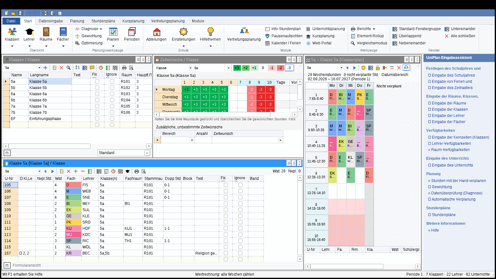

# UntPlan

**Stunden- und Vertretungsplanung für Schulen in Nordrhein-Westfalen.** UntPlan ist eine klassische Windows-Desktopanwendung (C#, Windows Forms).
Die Bedienung folgt dem Aufbau, den Schulen von gängigen Stundenplanprogrammen kennen: Menüband, Arbeitsfenster für Stammdaten,
Zeitwünsche, Unterricht und Stundenpläne, Drag & Drop beim manuellen Planen. Das macht den Umstieg leicht.



## Funktionen

- **Schuldaten:** Schuljahr, NRW-Schulformen, Zeitraster mit Vormittag, Nachmittag, fixer oder flexibler Mittagspause und Pausen, NRW-Ferien und -Feiertage (inkl. beweglicher Feiertage), A/B-Wochen.
- **Stammdaten:** Klassen, Lehrer, Räume, Fächer, Raumgruppen, Gänge, Abteilungen, Abwesenheitsgründe und Schüler.
  - Raster- und Formularansicht, gespeicherte Ansichten, Sortierung, Serienänderung, Kommentare, Umbenennen mit Verweisanpassung.
  - Räume: Ausweichraum-Ringe, Wanderklassen, Raumgewicht 0–4.
- **Zeitwünsche:** bestimmte Zeitwünsche (−3 … +3, Kernzeit) und unbestimmte Zeitwünsche, z. B. „ein freier Vormittag“.
- **Unterricht:** einfacher und gekoppelter Unterricht, Doppelstunden, Blöcke, Kursbänder, A/B-Wochen, befristeter Unterricht, Lehrervorschlag, Spalte „nicht verplant“ mit Drag & Drop.
- **Automatische Planung:**
  - Gewichtung (26 Kriterien, 0–5) mit Verteilungsgrafik und Analyse.
  - Optimierungsstrategien A, B, D und E mit mehreren Plänen, Bewertungszahl, Tausch- und Raumoptimierung.
  - Diagnose der Eingabedaten und des Stundenplans.
- **Manuelles Planen:**
  - Verplanen, Verschieben und Tauschen per Drag & Drop mit Farbkennzeichnung (grün, rot, violett).
  - Fixieren, Entplanen, Tauschvorschläge mit Gewinn.
  - Raumzuordnung (Verdrängen, Kollision zulassen, Tauschen), Übersichtspläne.
- **Stundenpläne:** Klassen-, Lehrer-, Raum- und Fachpläne, frei gestaltbare Formate (Grafik-Editor für Stundenfelder), Stundenlupe, Synchronisation, Druck, HTML, iCal.
- **Vertretungsplanung:**
  - Abwesenheiten von Lehrern, Klassen (mit Begleitlehrern) und Räumen.
  - Automatisch erzeugte offene Vertretungen und ein Vertretungsvorschlag mit einstellbarer Gewichtung.
  - **Bereitschaft:** Vertretungen aus einer Bereitschaftsstunde zählen nicht als Mehrarbeit.
  - Entfall-Vorschlag für Randstunden ab Jahrgang EF, außerdem Raumvertretung, Verlegung, Betreuung, Sondereinsatz, Klausur und statt-Vertretung.
  - Automatische Vertretung des ganzen Tages, Tagestexte.
- **Pausenaufsichten:** Gänge × Pausen × Tage, automatische Einteilung, Aufsichtsvertretungen.
- **Statistik:** Lehrer-Abrechnung mit der **NRW-Mehrarbeitsregel**: Vergütung erst ab mehr als 3 Stunden im Kalendermonat, abzüglich Minderstunden. Ausfallstatistik und CSV-Export.
- **Ausgabe des Vertretungsplans:** Druck, HTML in Schüler- und Lehrerversion, Monitoransicht für Info-Bildschirme.
- **Module:** Unterrichtsplanung und Wertrechnung (Soll/Ist, Werte-Faktoren, Unterrichts-Matrix, Stundentafel), Kursplanung für die Oberstufe (Kurswahlen, Kollisionsmatrix, automatische Bandbildung), Perioden, Abteilungsplanung.
- **Import und Export:** SchILD-NRW-CSV für Lehrer, Klassen und Schüler. GPU-Format für den Umstieg aus anderen Programmen. HTML, iCal und CSV.
- **WebPortal-Synchronisation:** Pläne und Vertretungen hochladen, Krankmeldungen von Lehrkräften abholen. Die Schnittstelle steht in [docs/SYNC_API.md](docs/SYNC_API.md), ein Referenzserver liegt unter `src/UntPlan.Portal`.
- **UntPlanWeb:** Stundenplan, Vertretungsplan, Monitore, Klassenbuch und Rückmeldungen (Abwesenheiten, Raumbuchungen, Klausuren) im Browser. Läuft als Docker-Container, siehe [web/README.md](web/README.md).
- **Hilfe (F1)** zu jedem Fenster, Eingabeassistent, Rückgängig und Wiederholen (50 Schritte).

Die Bedienung ist im **[Benutzerhandbuch](docs/HANDBUCH.md)** beschrieben.

## Installation

Die GitHub-Actions-Pipeline erzeugt bei jedem Push drei Artefakte:

- `UntPlan-Setup-x.y.z.exe`: Installer mit Startmenü-Eintrag und Dateiverknüpfung `.up`.
- `UntPlan-portabel`: eine einzelne `UntPlan.exe`, die ohne installiertes .NET läuft.
- `UntPlan-Portal`: der Portal-Referenzserver.

Systemvoraussetzung: Windows 10 oder 11 (x64).

## Entwicklung

```text
src/UntPlan.Core     Fachlogik (Modell, Optimierung, Vertretungsplanung, Module, Import/Export, Portal-Client) – net8.0
src/UntPlan.App      Windows-Oberfläche (WinForms, MDI, Menüband) – net8.0-windows
src/UntPlan.Portal   WebPortal-Referenzserver (ASP.NET Core)
tests/               xUnit-Tests (Optimierung, Vertretung, Planung, Austausch, Module, Portal Ende-zu-Ende)
installer/           Inno-Setup-Skript
```

```bash
dotnet test tests/UntPlan.Core.Tests
dotnet build src/UntPlan.App                       # baut auch unter Linux/macOS
dotnet publish src/UntPlan.App -c Release -r win-x64 --self-contained -p:PublishSingleFile=true
dotnet run --project src/UntPlan.Portal            # Portal unter http://localhost:5000
```

`UntPlan.exe --selbsttest=<Ordner>` öffnet mit der Beispielschule nacheinander alle Fenster. Dabei entstehen Bildschirmfotos und ein Protokoll. Die CI nutzt diesen Modus als Oberflächentest.

Schuldateien (`*.up`) sind JSON-Dateien. Beim Speichern wird eine Sicherung `*.bak` angelegt.

## Hinweis

UntPlan ist ein eigenständiges Programm und steht in keiner Verbindung zu Herstellern anderer Stundenplanprogramme.
Der GPU-Import dient ausschließlich der Datenübernahme beim Umstieg.
