# UntPlan – Benutzerhandbuch

Das Handbuch folgt dem Arbeitsablauf einer Stundenplanerstellung: Schuldaten → Stammdaten → Unterricht → automatische Planung → manuelles Planen → Stundenpläne → Vertretungsplanung → Module.
In der Anwendung erreichen Sie die passende Hilfeseite jederzeit mit **F1**.

> Die Bildschirmfotos stammen aus dem automatischen Selbsttest (`UntPlan.exe --selbsttest=…`) mit der Beispielschule. Sie wurden unter Wine aufgenommen, deshalb sehen Schriften und Fenstertitel unter Windows etwas anders aus.

## Inhalt

1. [Erste Schritte](#1-erste-schritte)
2. [Schuldaten](#2-schuldaten)
3. [Stammdaten](#3-stammdaten)
4. [Unterricht](#4-unterricht)
5. [Automatisches Verplanen](#5-automatisches-verplanen)
6. [Manuelles Planen](#6-manuelles-planen)
7. [Stundenpläne](#7-stundenpläne)
8. [Vertretungsplanung](#8-vertretungsplanung)
9. [Module](#9-module)
10. [Import, Export und WebPortal](#10-import-export-und-webportal)
11. [Tastenkürzel](#11-tastenkürzel)
12. [MultiUser](#12-multiuser)
13. [Bedienung: Tabellen, Suche, Formate](#13-bedienung-tabellen-suche-formate)

---

## 1. Erste Schritte

### Programmoberfläche

| Bereich | Beschreibung |
|---|---|
| Schnellzugriff (oben links) | Neu, Öffnen, Speichern, Rückgängig, Wiederholen, Drucken, Seitenansicht, Element-Rollup |
| Menüband | Registerkarten **Start**, **Dateneingabe**, **Planung**, **Stundenpläne**, **Kursplanung**, **Vertretungsplanung**, **Module**; links das Menü **Datei** |
| Arbeitsbereich | beliebig viele Fenster, die Sie verschieben und in der Größe ändern können; *Start → Standard-Fenstergruppe* stellt die abgebildete Anordnung her |
| Eingabeassistent (rechts) | Schritt-für-Schritt-Anleitung der Ersteingabe; ein- und ausblenden unter *Start → Hilfethemen* |
| Statuszeile | aktive Periode sowie Anzahl der Klassen, Lehrer und Unterrichte |

### Neue Schuldatei

*Datei → Neu*: Geben Sie den Schulnamen ein und wählen Sie die NRW-Schulform. UntPlan übernimmt dabei die NRW-Ferien und Feiertage sowie den NRW-Fächerkatalog (inkl. Bereitschaft BER).
*Datei → Beispielschule öffnen* lädt ein vollständiges Gymnasium zum Ausprobieren.

Eine Schuldatei (`*.up`) enthält alle Daten eines Schuljahres. Beim Speichern legt UntPlan automatisch eine Sicherung `*.bak` an.
Jede Änderung lässt sich mit **Strg+Z** rückgängig machen (50 Schritte).

**Automatisch speichern:** Unter *Einstellungen → Diverses* legen Sie das Intervall fest (Standard 10 Minuten, 0 = aus). Geänderte Daten werden dann in die geöffnete Datei gespeichert. Eine Datei ohne Namen landet als Wiederherstellungskopie im Benutzerordner (`%APPDATA%\UntPlan\Wiederherstellung`).

**Fensteranordnungen:** *Start → Fensteranordnungen* bzw. im Vertretungsmodus *Modus → Eigene Fensteranordnungen* speichert die aktuelle Anordnung unter einem Namen. Von dort laden und löschen Sie gespeicherte Anordnungen auch wieder. UntPlan öffnet beim Start den zuletzt benutzten Modus; abschaltbar unter *Einstellungen → Diverses*.

### Stundenplanung und Vertretungsplanung

UntPlan arbeitet in zwei Modi, die Sie unten im Menüband (*Modus*) oder mit **Strg+M** umschalten:

| Modus | Farbe | Inhalt |
|---|---|---|
| Stundenplanung | blau | Stammdaten, Unterricht, Planung, Optimierung, Module |
| Vertretungsplanung | grün | Kalender, Absenzen, Vertretungen, Vorschlag, Veranstaltungen, Klausuren, Pausenaufsichten, Statistik |

Jeder Modus merkt sich seine eigene Fensteranordnung. Titelleisten, Menüband und Fenster nehmen die Farbe des Modus an.
Unter Windows 11 gilt das auch für die Titelleiste des Hauptfensters.

**Auswahl wirkt auf alle Fenster:** Wählen Sie eine Vertretung, eine Stunde im Unterrichtsfenster oder eine Abwesenheit, zeigen alle geöffneten Stundenpläne mit eingeschalteter Synchronisation den zugehörigen Lehrer-, Klassen- bzw. Raumplan.
Die betroffene Stunde ist gestrichelt markiert.

---

## 2. Schuldaten

### Schuljahr und Einstellungen

*Start → Einstellungen*: Schulname, Schulnummer, Schulform, Region, Schuljahr von/bis und Wochenperiodizität (2 = A/B-Wochen).
Weitere Karteikarten:

- **Werte:** Wertrechnung, tagesgenau.
- **Vertretungsplanung:**
  - Mehrarbeitsgrenze, Standard 3 Stunden je Kalendermonat.
  - Entfall ab Jahrgang, Standard EF.
  - Titel des Vertretungsplans.
- **Diverses**

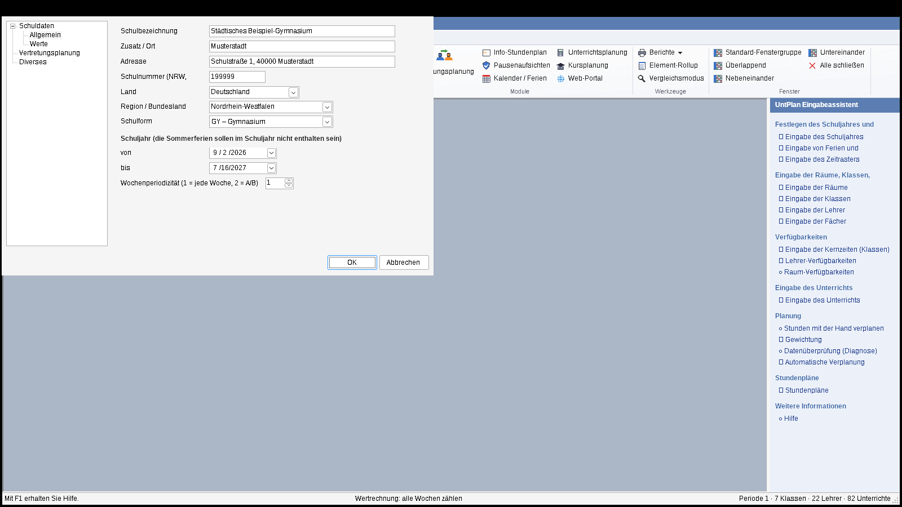

### Ferien

*Start → Kalender/Ferien*: Mit **NRW-Ferien und Feiertage eintragen** übernehmen Sie alle amtlichen Termine. Weitere freie Tage, z. B. bewegliche Ferientage, ziehen Sie mit gedrückter Maustaste im Jahreskalender auf.
Grün dargestellt sind Ferien, rot Feiertage und grau Wochenenden.

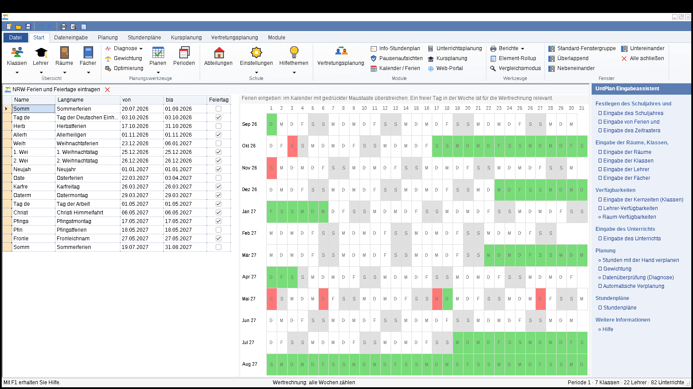

### Zeitraster

*Dateneingabe → Zeitraster*:

- Tage pro Woche, Stunden pro Tag, letzte Vormittagsstunde.
- Beginn und Ende jeder Stunde.
- Belegung jeder Stunde: Vormittag, Nachmittag oder leer (Mittagspause).

Auf der Karteikarte **Pausen** tragen Sie die Pausen mit Dauer ein. Ist **Aufsicht** markiert, plant das Modul Pausenaufsichten diese Pause.

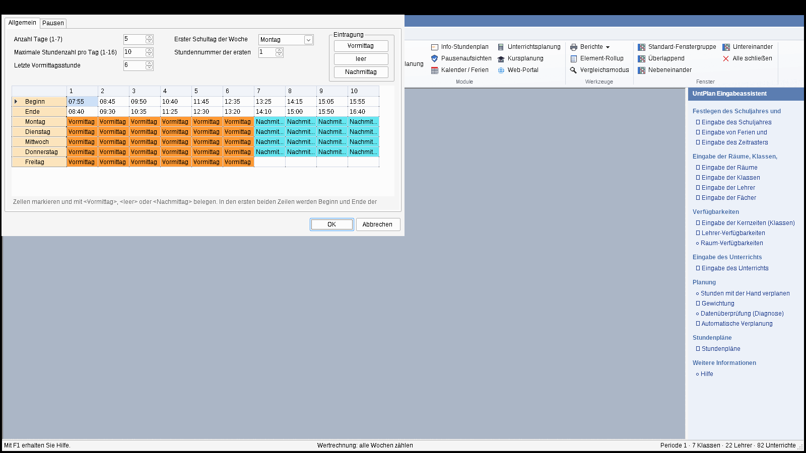

---

## 3. Stammdaten

Stammdaten sind die Grundelemente der Planung. Für jedes Element gibt es ein Stammdatenfenster mit **Rasteransicht** (Tabelle) und **Formularansicht** (Karteikarten).

- **Neues Element:** in die letzte, leere Zeile schreiben.
- **Umbenennen:** Doppelklick auf den Kurznamen. Alle Verweise werden mitgeführt.
- **Löschen:** Entf bzw. Schaltfläche. UntPlan zeigt, wo das Element verwendet wird.
- **Felder:** Ziehen Sie ein Feld per Drag & Drop aus der Formularansicht in die Tabelle, um es anzuzeigen; mit Strg+Ziehen blenden Sie es aus. Alternativ wählen Sie die Spalten unter *Felder der Ansicht*.
- **Ansichten:** Spaltenauswahl, Breiten und Sortierung lassen sich unter einem Namen speichern.
- **Sortieren:** mit bis zu drei Kriterien; *Umreihen* speichert die Reihenfolge dauerhaft.
- **Serienänderung:** mehrere Zeilen markieren und einem Feld für alle denselben Wert geben.
- **Kommentare:** über die rechte Maustaste. Kommentierte Felder tragen ein rotes Dreieck.

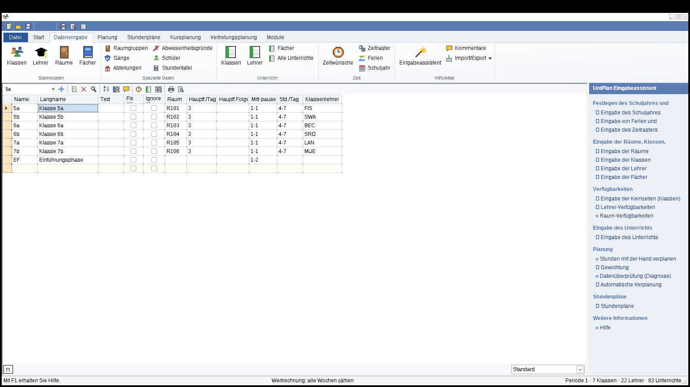

### Räume

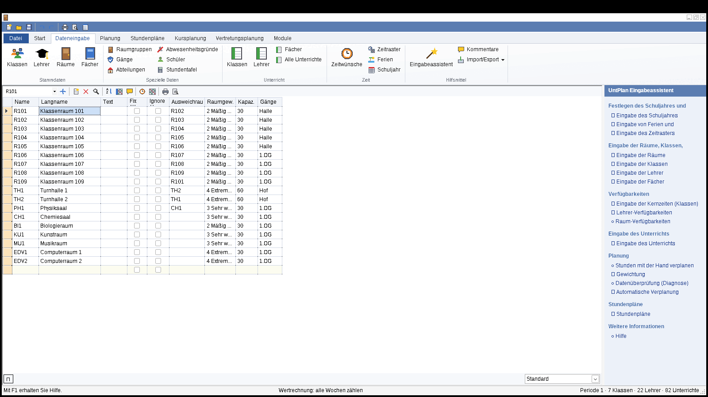

- **Ausweichraum:** Ist der gewünschte Raum belegt, wird der Ausweichraum verwendet. Mehrere Ausweichräume können einen **Ring** bilden (R101 → R102 → … → R101). Die Optimierung nutzt dann jeden freien Raum des Rings.
- **Wanderklassen:** Klassen ohne festen Stammraum erhalten einen freien Raum aus einem Ausweichraum-Ring.
- **Raumgewicht 0–4:** 0 bedeutet, der Unterricht darf auch ohne Raum stattfinden; 4 bedeutet, der Raum ist unverzichtbar (z. B. Sporthalle).
- **Raumgruppen:** gleichwertige Fachräume (EDV1, EDV2). Als Fachraum im Unterricht wählt die Optimierung einen freien Raum der Gruppe.
- **Raum sperren:** im Zeitwunschfenster den Wert **−3** eintragen.

### Klassen

Stammraum, Jahrgang, Klassenlehrer, Hauptfächer pro Tag und hintereinander, Mittagspause (min./max.), max. Nachmittage, Stunden pro Tag.
Die **Kernzeit** (Zeitwunsch +3) markiert Stunden, die unbedingt belegt sein sollen.

### Lehrer

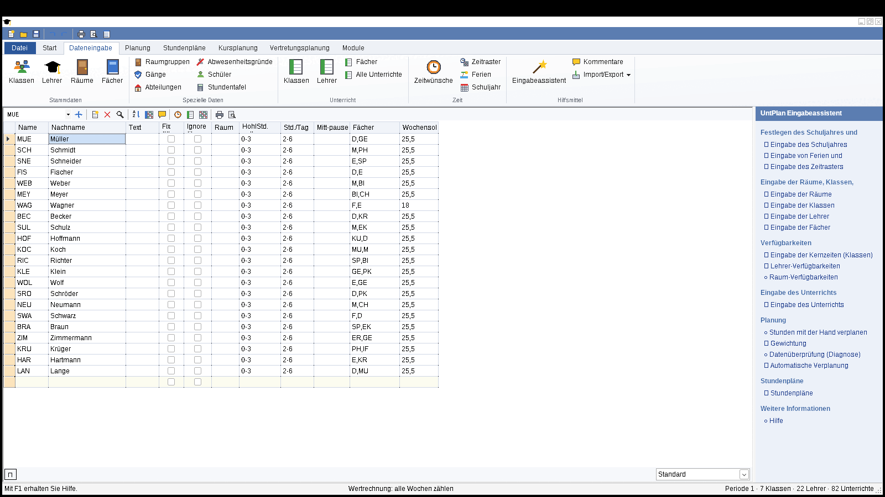

- **Wochensoll, Ermäßigungen und Lehrbefähigung (Fächer):** relevant für die Wertrechnung und den Lehrervorschlag.
- **Planung:** Hohlstunden min.–max., Stunden pro Tag, max. Nachmittage, Mittagspause.
- **Vertretung:** max. Vertretungen pro Woche/Monat, „keine Vertretung“.
- **Pausenaufsichten:** Aufsichten min./max., „keine Aufsicht“.

### Fächer

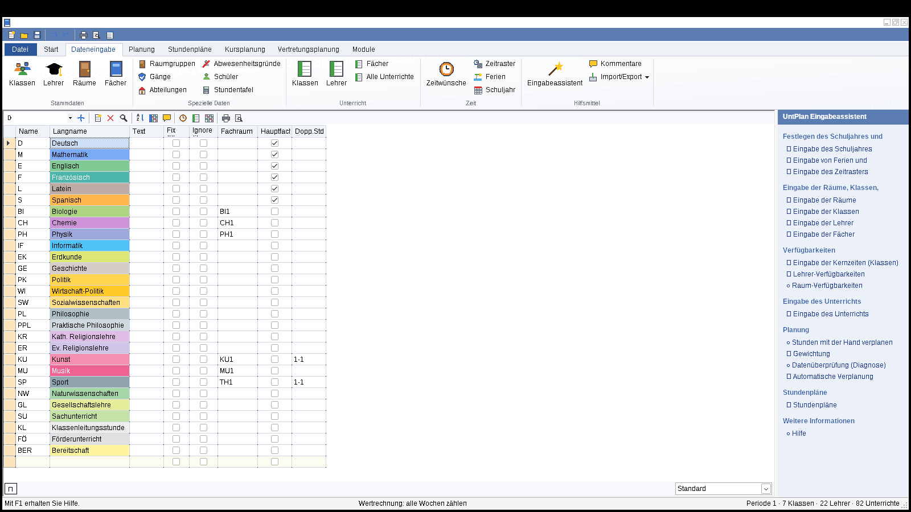

Fachraum oder Fachraumgruppe, Hauptfach, Werte-Faktor, Doppelstunden, „mehrmals pro Tag“, „Randstunde“, „kein Nachmittag“, Farbe.

**Bereitschaft:** Ein Fach mit dem Merkmal *Bereitschaft* (im NRW-Katalog: **BER**) ist kein echter Unterricht.

- Bereitschaftsstunden werden wie Unterricht verplant.
- In dieser Stunde steht der Lehrer für Vertretungen zur Verfügung und wird im Vertretungsvorschlag bevorzugt.
- Bereitschaftsvertretungen zählen **nicht** als Mehrarbeit.

### Zeitwünsche

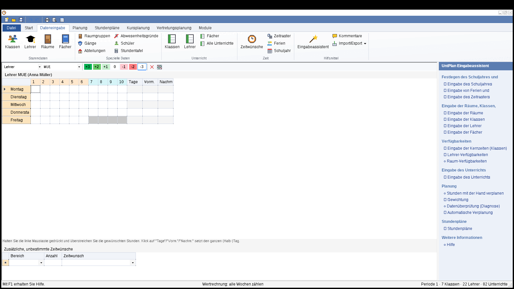

| Wert | Bedeutung |
|---|---|
| −3 | gesperrt (Stunde darf nicht belegt werden) |
| −2, −1 | möglichst nicht |
| 0 | neutral |
| +1, +2 | gern |
| +3 | unbedingt (Kernzeit) |

Wählen Sie den Wert oben und überstreichen Sie die Stunden mit gedrückter Maustaste. Ein Klick auf den Tagesnamen belegt den ganzen Tag, die Spalten **Vorm.** und **Nachm.** belegen nur den Vor- bzw. Nachmittag.

Im unteren Teil werden **unbestimmte Zeitwünsche** eingegeben, z. B. „1 Vormittag frei, Gewicht −2“: Der Lehrer möchte einen freien Vormittag, egal welchen.

---

## 4. Unterricht

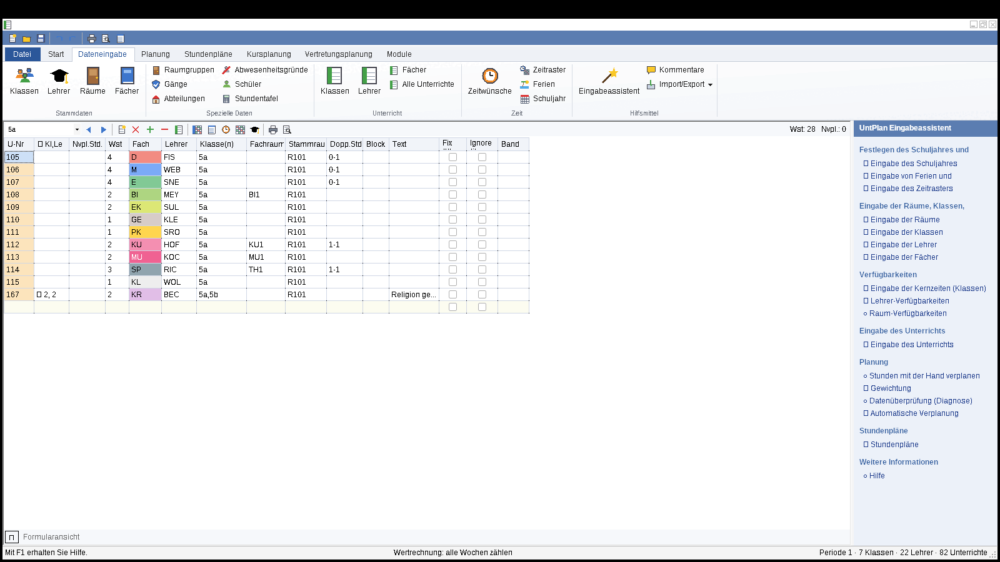

*Dateneingabe → Klassen → Unterricht*:

- **Spalten:** U-Nr. (wird automatisch vergeben), Wst. (Wochenstunden), Lehrer, Fach, Klasse(n), Fachraum, Stammraum, Doppelstunden, Block, Text.
- **Raumvorschlag:** Fachraum (aus dem Fach) und Stammraum (aus der Klasse) werden automatisch vorgeschlagen.
- **Spalte Nvpl.:** zeigt die nicht verplanten Stunden. Ziehen Sie eine Zahl in einen Stundenplan, um die Stunde dort zu verplanen.

Unterrichtsformen:

- **Kopplung:** Mehrere Lehrer und Klassen unterrichten gleichzeitig, z. B. Religion KR/ER/PP für 6a und 6b. Fügen Sie dafür Kopplungszeilen hinzu; mit **⊞** blenden Sie die Zeilen ein und aus.
- **Doppelstunde:** Feld Doppelstd. min–max, z. B. `1-1`.
- **Block:** z. B. `3` für Dreierblöcke.
- **Band:** Unterrichte mit gleichem Band (z. B. Kursschiene `EF-1`) werden immer parallel gelegt.
- **A/B-Woche, befristet von–bis, Werte-Faktor:** in der Formularansicht.

**Lehrervorschlag:** Für die markierte Kopplungszeile schlägt UntPlan Lehrer mit passender Lehrbefähigung und freiem Deputat vor.

---

## 5. Automatisches Verplanen

### Gewichtung

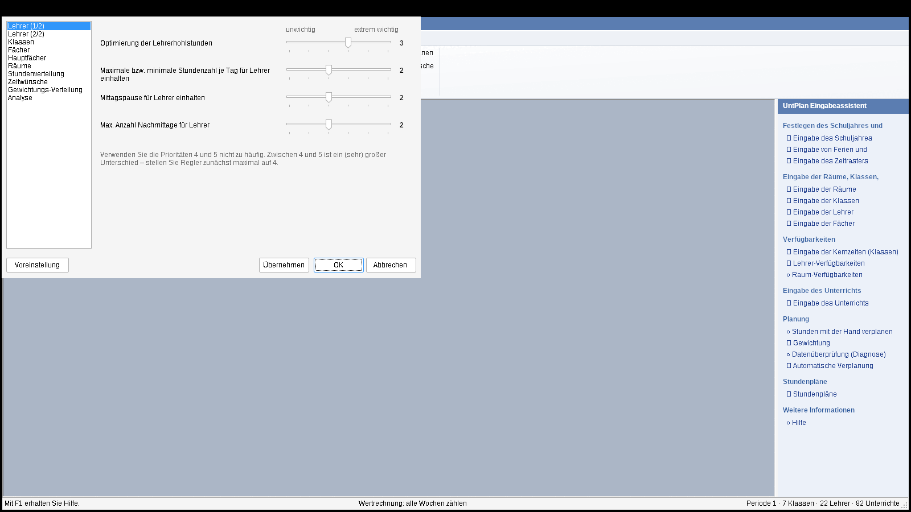

*Planung → Gewichtung*: 26 Kriterien in den Karteikarten Lehrer, Klassen, Fächer, Hauptfächer, Räume, Stundenverteilung und Zeitwünsche. Jedes Kriterium hat ein Gewicht von 0 (unwichtig) bis 5 (extrem wichtig).

- *Gewichtungs-Verteilung* zeigt die Gewichte im Verhältnis zueinander.
- *Analyse* nennt die Kriterien, die mit den aktuellen Daten schwer zu erfüllen sind.

Tipp: Verwenden Sie die Stufen 4 und 5 sparsam.

### Optimierung

*Planung → Optimierung*:

| Strategie | Verwendung |
|---|---|
| A – Schnelloptimierung | erster Überblick, wenige Sekunden bis Minuten |
| B – Normaloptimierung | Standard |
| D – Intensivoptimierung | mehrere Pläne mit Tauschoptimierung |
| E – Nächtliche Optimierung | lange Laufzeit, viele Pläne |

Optional stellen Sie ein:

- Anzahl der Pläne.
- Optimierungsschritte 1–9.
- Start- und Erhöhungsprozentsatz für schrittweises Verplanen.

Nach dem Lauf erscheinen alle Pläne mit **Bewertungszahl** und Kennzahlen (nicht verplant, Hohlstunden, Zeitwunschverletzungen …). Kleiner ist besser. Der beste Plan ist gelb markiert und wird mit **OK** übernommen.
Fixierte Stunden (*) bleiben unverändert.

Zur Mittagspause: Mit *fix* ist eine Stunde immer frei. Mit *flexibel* bleibt innerhalb des Bereichs (z. B. 6.–7. Stunde) mindestens eine Stunde frei.

### Diagnose

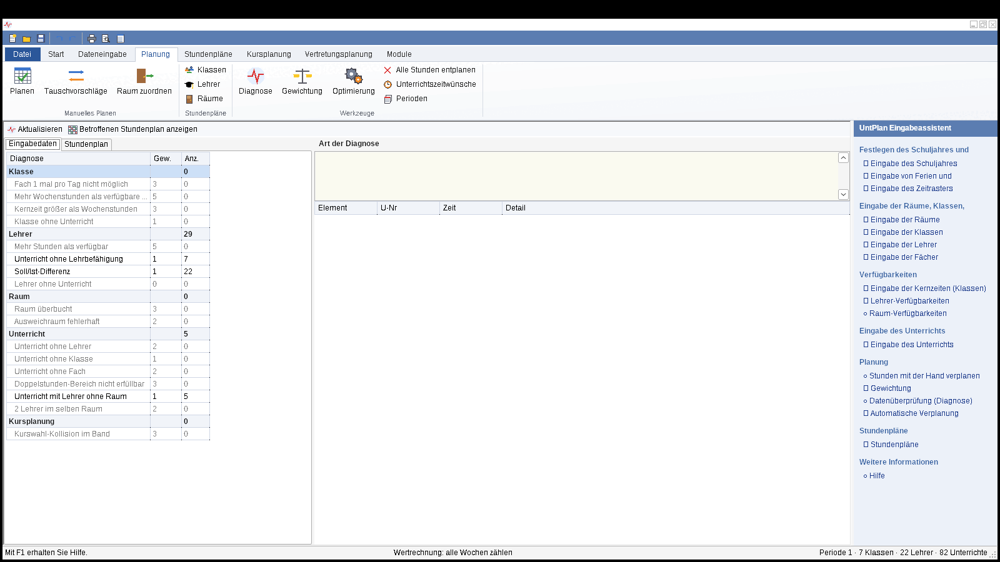

*Planung → Diagnose*: Die Karteikarte **Eingabedaten** prüft vor der Optimierung, z. B. Lehrer mit mehr Stunden als verfügbaren Zeiten, Unterricht ohne Lehrer oder Raum und Soll-Ist-Differenzen.
Die Karteikarte **Stundenplan** listet die Verstöße des aktuellen Plans. Rechts stehen Beschreibung und Einzelfälle; ein Doppelklick öffnet den betroffenen Stundenplan.

---

## 6. Manuelles Planen

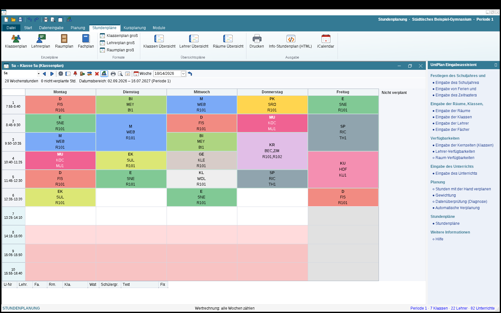

### Verplanen, Verschieben, Tauschen

Ziehen Sie eine Stunde aus der Liste *Nicht verplant* oder aus dem Plan auf ein Feld. Während des Ziehens sind die Felder eingefärbt:

| Farbe | Bedeutung |
|---|---|
| grün | Verplanung ohne Kollision möglich |
| rot | kollisionsfrei, aber Vorgabe verletzt (Sperrung, negativer Zeitwunsch) |
| violett | kollisionsfrei, aber kein passender Raum frei |
| grün hinterlegte Stunde | Tausch möglich |
| ohne Farbe | Kollision |

Wird auf eine belegte Stunde gezogen, fragt UntPlan nach **Tauschen** oder **Verdrängen** (die behindernde Stunde wird entplant).

- **Fixieren** (*): Die Stunde wird von der Optimierung nicht verändert.
- **Entplanen** (Entf): Die Stunde wandert zurück in die Liste der nicht verplanten Stunden.
- **Tauschvorschläge:** Für die markierte Stunde zeigt UntPlan alle kollisionsfreien Tausche, sortiert nach **Gewinn** (Verbesserung der Bewertungszahl). Ein Doppelklick führt den Tausch aus.

### Raumzuordnung

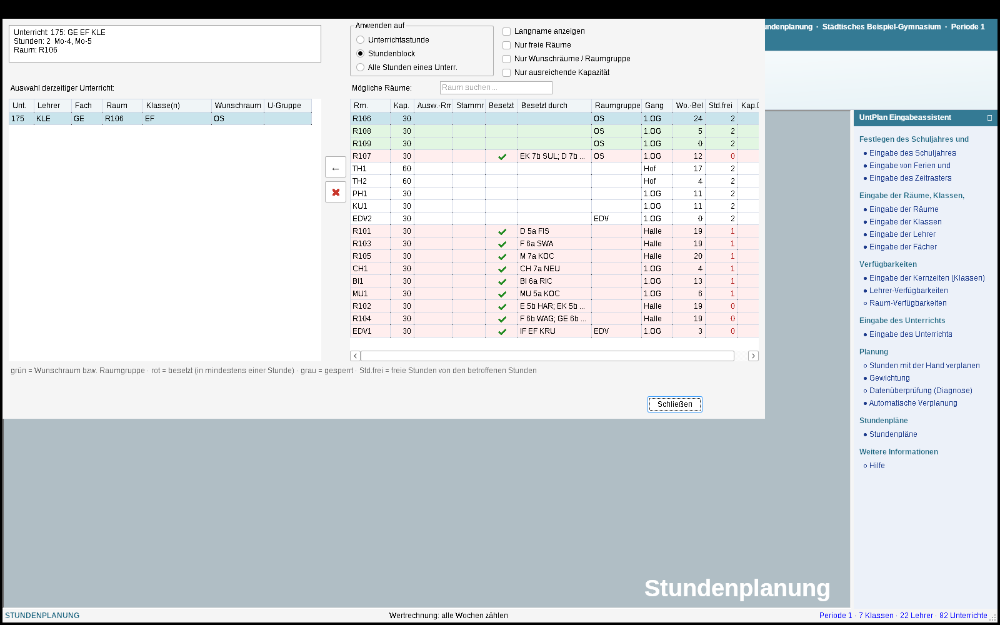

*Raum zuordnen / löschen* zeigt links die Kopplungszeilen des Unterrichts und rechts alle möglichen Räume.

**Anwenden auf:** die markierte Unterrichtsstunde, den ganzen Stundenblock oder alle Stunden des Unterrichts.

**Spalten der Raumliste:**

| Spalte | Bedeutung |
|---|---|
| Kap. | Kapazität des Raums |
| Ausw.-Rm. | Ausweichraum des Wunschraums |
| Stammr. | Stammraum einer beteiligten Klasse |
| Besetzt / Besetzt durch | belegt durch anderen Unterricht; A/B-Wochen werden beachtet |
| Raumgruppe, Gang | Zuordnung des Raums |
| Wo.-Bel. | Belegung des Raums in der Woche |
| Std.frei | in wie vielen der betroffenen Stunden der Raum frei ist |
| Kap.Diff. | Kapazität minus Schülerzahl der Klassen |

**Farben:** grün = Wunschraum bzw. Raumgruppe, rot = besetzt, grau = gesperrt.

**Filter:**

- nur freie Räume
- nur Wunschräume
- nur ausreichende Kapazität
- Suchfeld
- Langnamen anzeigen

**Bedienung:** Doppelklick, Enter oder ← ordnet den Raum zu; das Löschsymbol bzw. Entf entfernt ihn.

Ist der gewählte Raum belegt, haben Sie drei Möglichkeiten:

- **Verdrängen:** Der andere Unterricht verliert den Raum.
- **Räume tauschen.**
- **Kollision zulassen.**

In der **Übersicht** (Raumplan quer) verlegen Sie Räume per Drag & Drop.

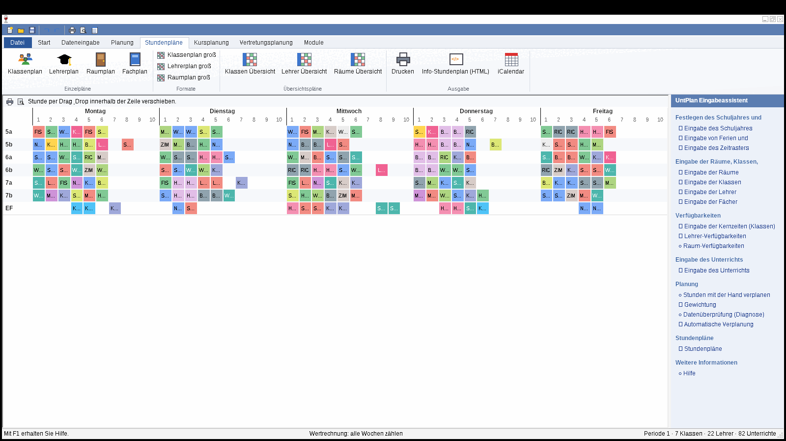

---

## 7. Stundenpläne

- **Planarten:** Klassen-, Lehrer-, Raum- und Fachpläne, jeweils normal oder groß.
- **Blöcke:** Doppelstunden und Blöcke erscheinen als ein Feld. Gleichzeitige Stunden und Blöcke stehen immer nebeneinander.
- **Synchronisation:** Ein Klick auf eine Stunde, z. B. im Lehrerplan, stellt die geöffneten Klassen- und Raumpläne auf die Klasse bzw. den Raum dieser Stunde um. Bei Kopplungen gilt nur die Zeile der Lehrkraft. Das funktioniert auch im tagesaktuellen Plan des Vertretungsmodus.
- **Vertretungsmodus:** Die Pläne sind kompakter und passen ohne Blättern auf die Seite.
- **Durchschalten:** ◄ ► neben der Elementauswahl wechselt zum vorherigen bzw. nächsten Element.
- **Auswahl:** oben im Fenster. Mit **Synchronisation** folgt der Plan der Auswahl in anderen Fenstern.
- **Woche:** Mit *Woche* sehen Sie den Plan einer bestimmten Kalenderwoche mit eingetragenen Vertretungen.
- **Stundenlupe:** zeigt unten alle Details der markierten Stunde.
- **Eigene Stundenplanformate:** Die Auswahl in der Werkzeugleiste wechselt zwischen den Formaten der Planart. Über das Zahnrad legen Sie neue Formate an (als Kopie), bearbeiten, benennen sie um oder löschen sie. Jedes Fenster merkt sich das zuletzt gewählte Format.
- **Formate:** In den *Stundenplaneinstellungen* legen Sie Schriftgröße, Farben, Zeitanzeige und die angezeigten Felder fest. Im Grafik-Editor *Stpl-Stunde* positionieren Sie die Felder einer Stunde frei, mit Hilfslinien.
- **Ausgabe:** Druck (mit Druckauswahl mehrerer Elemente), HTML für die Homepage, Info-Stundenplan (alle Pläne als Webseiten), iCal-Kalender je Lehrer.

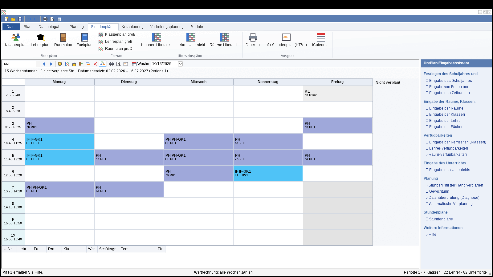

---

## 8. Vertretungsplanung

### Abwesenheiten

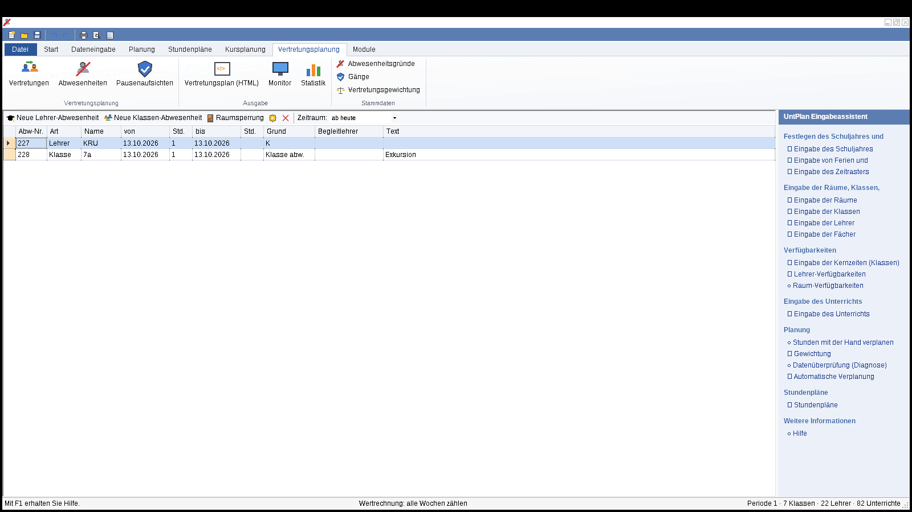

*Vertretungsplanung → Abwesenheiten*: Geben Sie Lehrer-, Klassen- und Raumabwesenheiten mit Datum, Stunde von/bis, Grund und Text ein.

- **Klassenabwesenheit:** Begleitlehrer gelten ebenfalls als abwesend. Der Unterricht der Klasse wird zur **Freisetzung**; die freigesetzten Lehrer stehen für Vertretungen zur Verfügung (Minusstunden).
- Mit dem Speichern erzeugt UntPlan sofort die **offenen Vertretungen** (rot `???`, nicht fett).
- **Datumsfelder** in Tabellen (Absenzen, Veranstaltungen, Klausuren, Tagestexte, Ferien, Unterrichtsgruppen) haben eine Datumsauswahl mit Kalender. Eintippen ist weiterhin möglich, z. B. `14.10.`, `h` für heute oder `+3`.
- **Direkteingabe:** Am Ende der Liste steht immer eine leere Zeile *neu*. Tippen Sie dort Lehrer, Datum und Stunden ein, ohne einen Dialog zu öffnen. Das gilt ebenso für **Veranstaltungen**, **Klausuren** und **Tagestexte**.
- **Hinweis bei geplanten Vertretern:** Wird ein Lehrer abwesend, der bereits als Vertreter eingeteilt ist, meldet UntPlan die betroffenen Vertretungen. Diese werden wieder offen.
- Mit **Teilen**, **Kopieren** und **Zusammenfassen** bearbeiten Sie mehrere Abwesenheiten auf einmal.

### Vertretungsfenster

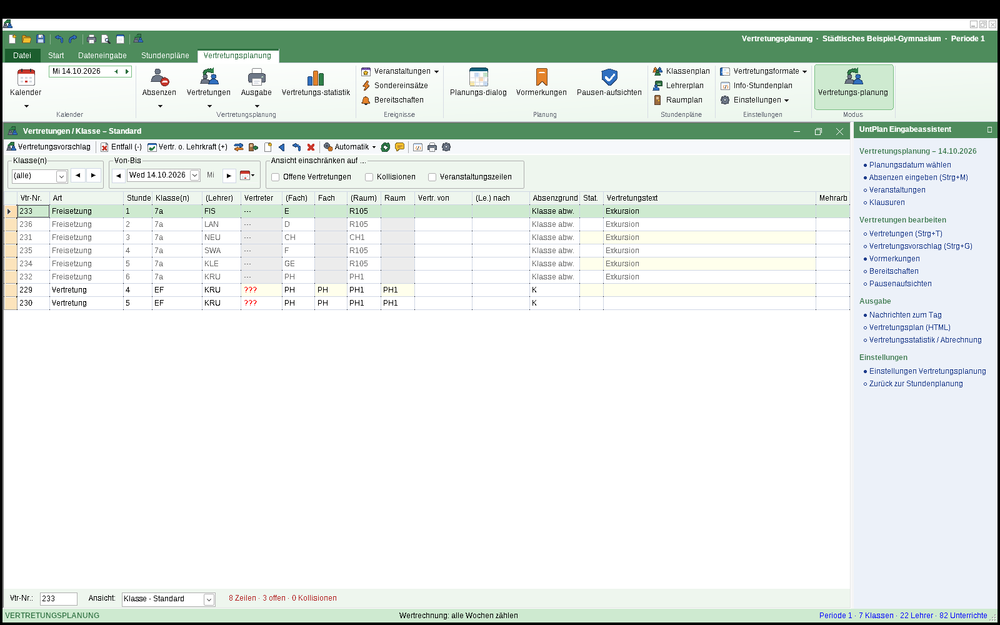

**Kopfbereich:**

- **Klasse(n)** bzw. **Lehrer:** Auswahl mit „(alle)“ und ◄ ►.
- **Von-Bis:** Datum mit Wochentag und ◄ ►. Über die Kalenderschaltfläche wählen Sie **Tag**, **Woche** oder **Von-Bis**.
- **Ansicht einschränken auf …:** offene Vertretungen, Kollisionen, Veranstaltungszeilen.
- **Vtr-Nr.** (unten): zeigt die Nummer der markierten Vertretung. Eine eingetippte Nummer springt zu dieser Vertretung.

Bei Veranstaltungen zeigt die Liste nur die Freisetzungen, Entfälle und Vertretungen. Die Zeilen der Veranstaltung selbst blendet *Veranstaltungszeilen* ein.

Arbeitsablauf:

1. Tag wählen. Oben sehen Sie Wochentyp, Anzahl offener Vertretungen sowie abwesende Lehrer und Klassen.
2. Offene Vertretung markieren. Der **Vertretungsvorschlag** zeigt alle freien Lehrer mit Punkten und Kriterien:
   - Bereitschaft, freigesetzt, kennt die Klasse, Fachlehrer.
   - Lage: Hohlstunde, anschließend, verlängert den Tag, sonst frei.
   - Vertretungen in Woche, Monat und Jahr, Saldo.
3. Mit Doppelklick oder **Vertreter zuweisen** übernehmen. Alternativ:
   - **Entfall** – UntPlan schlägt ihn ab Jahrgang EF in Randstunden vor.
   - **Betreuung**, **Raumvertretung** (Liste freier und frei gewordener Räume), **Verlegung** (mit Prüfung, ob Lehrer und Klasse frei sind).
   - **Sondereinsatz**, **Klausur**.
4. **Automatische Vertretung des Tages** plant alle offenen Vertretungen nach dem Vorschlag.

Die Spalten **Vertreter**, **Fach**, **Raum** und **Text** können Sie direkt überschreiben.
In der Auswahlliste *Vertreter* sind belegte Lehrer rot und Lehrer mit Bereitschaft grün; Sie können in der Liste suchen, indem Sie tippen.

- **Zusammenhängende Stunden** (Doppel- und Blockstunden) erscheinen im Tagesplan als ein Block.
- **Drag & Drop im Tagesplan:** Beim Ziehen fragt UntPlan, ob nur die Stunde oder der ganze Block verlegt werden soll und wie mit Kollisionen umzugehen ist (Tauschen, Verdrängen, Kollision zulassen).
- **Ansichten:** Klasse, Lehrer, Druck und Pausenaufsichten.
- **Filter:** *Offene Vertretungen*, *Kollisionen*.
- **Tasten:** `+` setzt *Vertretung ohne Lehrkraft*, `-` setzt *Entfall*, **F3** springt zur nächsten offenen Vertretung (Umschalt+F3 zur vorherigen).
- **Flüssige Auswahl:** Beim Blättern mit den Pfeiltasten werden die Stundenpläne erst aufgebaut, wenn die Auswahl stehen bleibt. Mit *Weiter zur nächsten offenen* im Vertretungsvorschlag wählt UntPlan nach jedem Zuweisen automatisch die nächste offene Vertretung.
- **Betreuungen:** Der Reiter *Betreuungen* sortiert nach Nähe: gekoppelt, gleicher Gang, gleiches Stockwerk. Danach zählt, ob die Lehrkraft die Klasse kennt, wie viele Betreuungen sie heute schon hat und ihr Vertretungszähler. *Nur in der Nähe* blendet weiter entfernte Lehrkräfte aus.

- **Bereitschaft:** Lehrer mit Bereitschaftsstunde stehen grün ganz oben; ihre Vertretung ist keine Mehrarbeit, im Aushang steht die Bemerkung „Bereitschaft“. Bereitschaften selbst werden nie vertreten: Fehlt die Lehrkraft, entfällt die Bereitschaft.
- **statt-Vertretung:** Ein freigesetzter Lehrer vertritt.
- **Vertretungsgewichtung** (Menüband): Hier legen Sie fest, wie stark jedes Kriterium im Vorschlag zählt (0–5).
- **Pausenaufsicht-Vertretungen:** Fällt eine Aufsicht durch Abwesenheit aus, erscheint sie auf der gleichnamigen Karteikarte. Dort wählen Sie einen Vertreter.
- **Tagestext:** Nachrichten zum Tag für alle oder nur für Lehrer.

### Pausenaufsichten

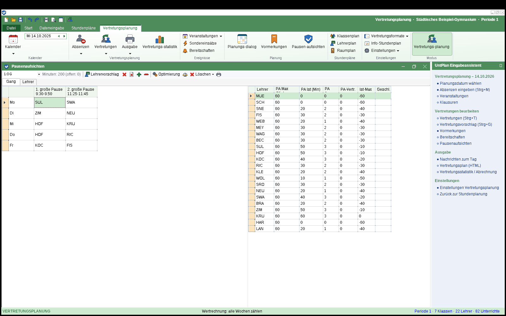

Das Fenster hat die Karteikarten **Gang** und **Lehrer**:

- **Gang:** Wählen Sie oben den Aufsichtsbereich. Die Matrix zeigt Tage × Aufsichtspausen. Der Spaltenkopf nennt die Pause mit Ende und Beginn der angrenzenden Stunden.
- **Lehrer:** zeigt die Aufsichten des gewählten Lehrers; grün = anwesend, rot = eigentlich nicht verfügbar.
- Neben der Auswahl stehen die Minuten des Elements und wie viele davon noch offen sind.

**Zellen der Matrix:**

| Anzeige | Bedeutung |
|---|---|
| Kürzel | eingeteilter Lehrer |
| `???` | Aufsicht nötig, noch niemand eingeteilt |
| grau | keine Aufsicht |
| rot | Einteilung verletzt eine Vorgabe |

Sie können ein Lehrer-Kürzel direkt in die Zelle tippen.

**Werkzeugleiste:**

- **Lehrervorschlag:** listet alle Lehrer mit Bewertung (Anwesenheit vor bzw. nach der Pause, Zeitwünsche, Minimal- und Maximalwerte). Ein Doppelklick trägt den Lehrer ein.
- **Aufsicht löschen** und **Aufsicht (???) / Keine Aufsicht** bearbeiten die markierte Zelle.
- **Aufsicht teilen** bzw. **Teilung entfernen:** teilt eine Pause auf bis zu neun Lehrer auf, z. B. für die erste und zweite Hälfte.
- **Optimierung** verteilt die offenen Aufsichten automatisch. Die **Gewichtung** legt fest, wie stark jedes Kriterium zählt und wie viele Aufsichten ein Lehrer höchstens pro Tag hat.

Rechts steht die Übersicht aller Lehrer mit Soll, Ist, Anzahl und Pausenaufsicht-Vertretungen. Ein Doppelklick öffnet die Lehreransicht.

### Kalender, Veranstaltungen, Klausuren, Bereitschaften

- **Kalender:** Wochenübersicht mit der Anzahl der Abwesenheiten und Vertretungen je Tag. Auf der zweiten Karteikarte bearbeiten Sie die Tagestexte direkt.
- **Veranstaltungen** (Exkursionen, Konferenzen, Projekttage) und **Klausuren** werden in der Liste direkt eingetragen. Das Veranstaltungsfenster zeigt den gewählten Zeitraum (Tag, Woche, Von-Bis); *VA-Nr.* springt zu einer Veranstaltung. Beteiligte Klassen, Lehrer und Räume gelten in diesem Zeitraum als abwesend bzw. belegt.
- **Sondereinsätze:** Raster mit Klassen und Lehrern, dazu eine Schaltfläche für eine Klassenkonferenz.
- **Bereitschaften:** zeigt, wer am gewählten Tag in welcher Stunde Bereitschaft hat und ob diese schon für eine Vertretung verbraucht ist.
- **Vormerkungen:** Ziehen Sie eine Vormerkung in den Tagesplan, um sie zu verplanen.

### Statistik und NRW-Mehrarbeit

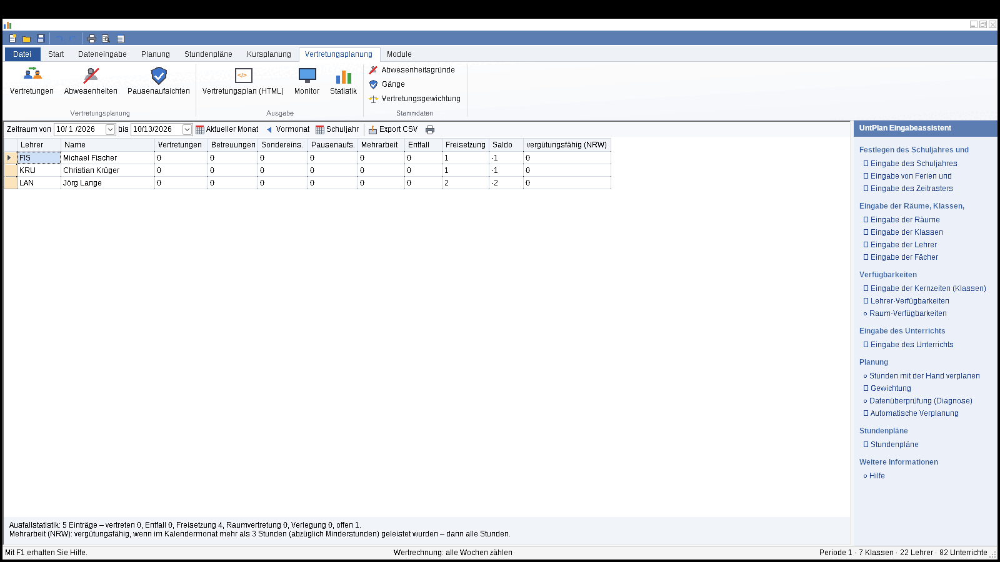

Je Lehrer zeigt die Statistik Vertretungen, Betreuungen, Sondereinsätze, Pausenaufsichten, Mehrarbeit, Entfälle, Freisetzungen, Saldo und **vergütungsfähige Mehrarbeit nach NRW-Regel**:
Werden in einem Kalendermonat mehr als 3 Stunden Mehrarbeit geleistet (Grenze einstellbar, Minderstunden werden verrechnet), sind alle Stunden vergütungsfähig.
Die Liste lässt sich drucken oder als CSV exportieren.

Weitere Berichte:

- Abrechnung und Einzelnachweis je Lehrer.
- Mehrarbeit NRW und Monatsabrechnung, mit Unterschriftszeile.
- Entfalltage.
- Übersicht und Wochenwerte.

### Vertretungsplan ausgeben

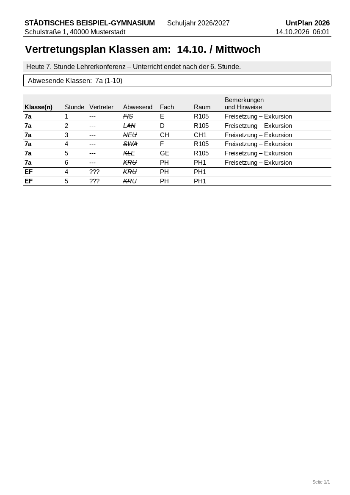

- **Druck (Aushang):** *Vertretungsplan drucken* im Vertretungsfenster, eine Seite je Tag.
  - **Kopf:** Schule, Schuljahr, Adresse, Druckzeitpunkt.
  - **Titel:** z. B. „Vertretungsplan Klassen am: 24.9. / Donnerstag“.
  - **Kästen:** Nachrichten zum Tag, blockierte Räume, abwesende Klassen bzw. Lehrer.
  - **Tabelle:** Klasse(n), Stunde, Vertreter, Abwesend (durchgestrichen), Fach, Raum, Bemerkungen und Hinweise (z. B. Bereitschaft, Raumänderung, verlegt von …). Gruppen sind durch Linien getrennt.
  - **Optionen vor der Seitenansicht:** Klassen- oder Lehrerversion, Schriftart und -größe, Hoch-/Querformat und welche Kästen erscheinen.
- **Liste drucken:** druckt die Tabelle so, wie sie angezeigt wird (mit eigenem Spaltenformat).
- **HTML:** Schüler- und Lehrerversion, die Lehrerversion mit abwesenden Lehrern und Pausenaufsichten.
- **Monitor:** Vollbild für Info-Bildschirme mit heute und dem nächsten Schultag, automatischem Seitenwechsel und Aktualisierung. ESC beendet.

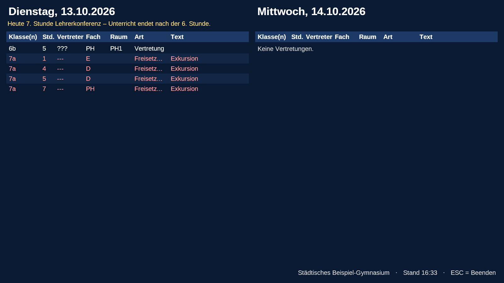

---

## 9. Module

### Unterrichtsplanung und Wertrechnung

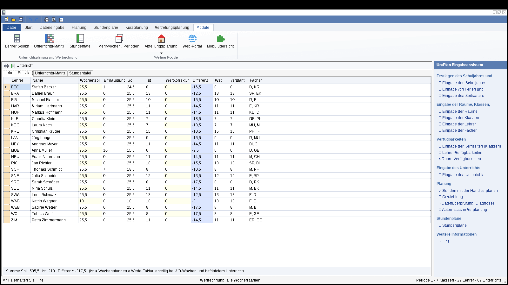

- **Lehrer Soll/Ist:** Soll = Wochensoll − Ermäßigungen. Ist = Summe der Werte (Wochenstunden × Werte-Faktor, anteilig bei A/B-Wochen und befristetem Unterricht) + Wertkorrektur. Wochensoll und Wertkorrektur sind direkt editierbar.
- **Unterrichts-Matrix:** Klassen × Fächer mit Lehrern und Stunden.
- **Stundentafel:** Soll-Stunden je Jahrgang und Fach mit Abgleich gegen den eingegebenen Unterricht.

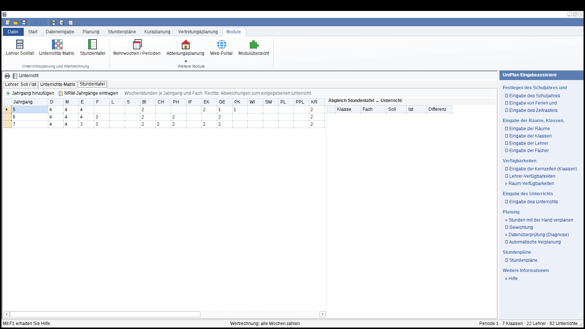

### Kursplanung (Oberstufe)

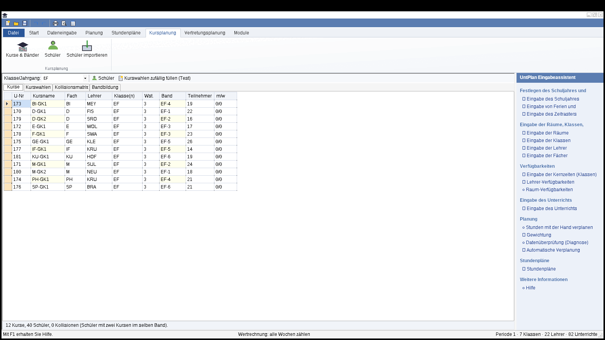

- **Kurse:** Unterrichte mit Kursname, Band und Teilnehmerzahl.
- **Kurswahlen:** Schüler × Kurse zum Ankreuzen.
- **Kollisionsmatrix:** Anzahl der Schüler mit beiden Kursen. Rot bedeutet Kollision im selben Band.
- **Bandbildung:** Die Kurse werden automatisch auf möglichst wenige Bänder verteilt, ohne Schüler- oder Lehrerkollision. *Bänder übernehmen* schreibt das Ergebnis in den Unterricht.

### Perioden

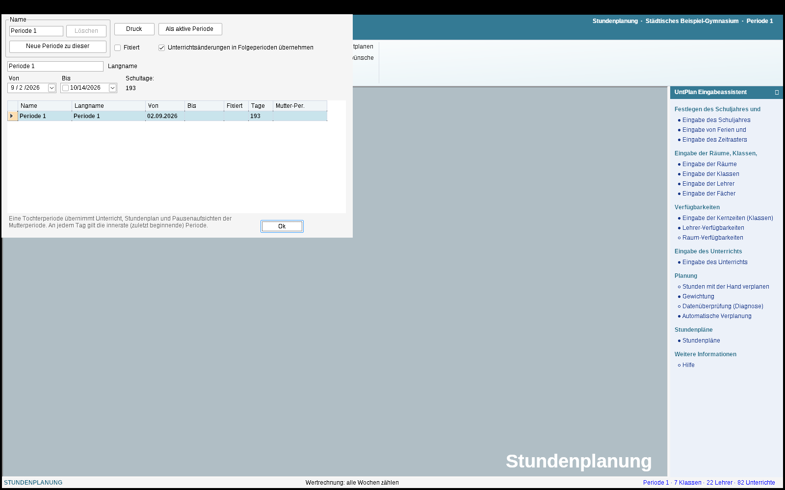

Perioden sind verschiedene Stundenpläne für Abschnitte des Schuljahres, z. B. ab dem 2. Halbjahr oder für eine Projektwoche. Sie verwalten sie unter *Planung → Perioden*.

- **Neue Periode:** wird als Tochter der markierten (Mutter-)Periode angelegt. Sie übernimmt deren Unterricht, Stundenplan und Pausenaufsichten.
  - Beginn und Ende müssen im Schuljahr und innerhalb der Mutterperiode liegen.
  - Ohne Endedatum gilt die Periode bis zum Beginn der nächsten Periode derselben Ebene.
- **Gültigkeit:** An jedem Tag gilt die innerste Periode. Die Spalte *Schultage* zeigt, an wie vielen Unterrichtstagen sie tatsächlich gilt.
- **Fixieren:** Eine fixierte Periode lässt sich nicht ändern oder löschen. Weitergegebene Änderungen erreichen sie ebenfalls nicht.
- **Änderungen weitergeben** (Kontrollkästchen *Unterrichtsänderungen in Folgeperioden übernehmen* im Periodendialog): Unterrichtsänderungen werden in die Tochterperioden übernommen, sofern der Unterricht dort noch unverändert ist. Bewusst abweichender Unterricht bleibt erhalten.
- **Löschen:** Stammdaten werden aus allen Perioden entfernt. Tochterperioden einer gelöschten Periode hängen danach an deren Mutter.
- **Vertretungsplanung:** Mit dem Datum wechselt automatisch die gültige Periode. Die Statuszeile zeigt sie an; ein Klick darauf wählt eine andere Periode.

### Bereitschaftsplanung

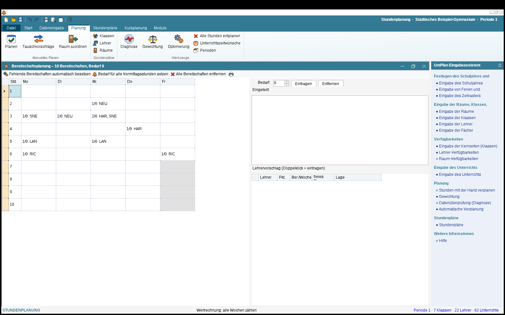

*Dateneingabe → Bereitschaftsplanung* zeigt Tage × Stunden mit Bedarf, Anzahl eingeteilter Lehrer und deren Kürzeln.

- **Bedarf einer Stunde:** links wählen. **Bedarf für alle Vormittagsstunden setzen** füllt die übliche Grundversorgung auf einmal.
- **Lehrervorschlag:** listet freie Lehrer mit Punkten, Bereitschaften pro Woche, freien Stunden und Lage (Hohlstunde, Tagesrand). Ein Doppelklick teilt den Lehrer ein.
- **Fehlende Bereitschaften automatisch besetzen** verteilt den offenen Bedarf gleichmäßig.
- **Bereitschaften nur als Doppelstunden verplanen:** Die Automatik besetzt dann immer zwei aufeinanderfolgende Stunden mit demselben Lehrer, bevorzugt zwei Stunden mit offenem Bedarf. Dabei werden Zeitwünsche und die Wertrechnung beachtet.

### Unterrichtsgruppen (A/B-Wochen)

*Dateneingabe → Unterrichtsgruppen* legt Gruppen wie *A-Woche*, *B-Woche* oder *1. Halbjahr* mit Kalenderwochen bzw. Zeitraum fest.
Weisen Sie im Unterrichtsfenster einem Unterricht oder einer Unterrichtszeile eine Gruppe zu. Dann gelten zwei Stunden zur gleichen Zeit nur als Kollision, wenn sich ihre Wochen überschneiden. Raumbelegung und Wertrechnung rechnen anteilig.

### Abteilungsplanung

Exportieren Sie eine Abteilungsdatei, planen Sie die Abteilung getrennt und führen Sie das Ergebnis wieder zusammen. Elemente und Unterrichte werden über das Feld *Abteilung* zugeordnet.

---

## 10. Import, Export und WebPortal

| Funktion | Format |
|---|---|
| Lehrer-, Klassen-, Schülerimport | CSV (z. B. aus SchILD-NRW), Spalten werden anhand der Überschriften erkannt |
| Umstieg aus anderen Programmen | GPU-Dateien (GPU001–GPU006) |
| Export | GPU, HTML-Stundenpläne, Info-Stundenplan, Vertretungsplan, iCal, CSV |

**BAL-Import:** *Dateneingabe → BAL-Import* (oder *Import/Export*) übernimmt einen Stundenplan aus einer WILLI2-BAL-Datei. Wahlweise werden Zeitraster, Stammdaten, Zeitwünsche, Unterricht, Stundenplan und Pausenaufsichten übernommen. Fehlende Elemente werden angelegt.

**UntPlanWeb** (oberste Leiste *UntPlanWeb*: alles oder einzelne Teile direkt übertragen; ausführlich im Menü *Datei → UntPlanWeb → Datenaustausch*):

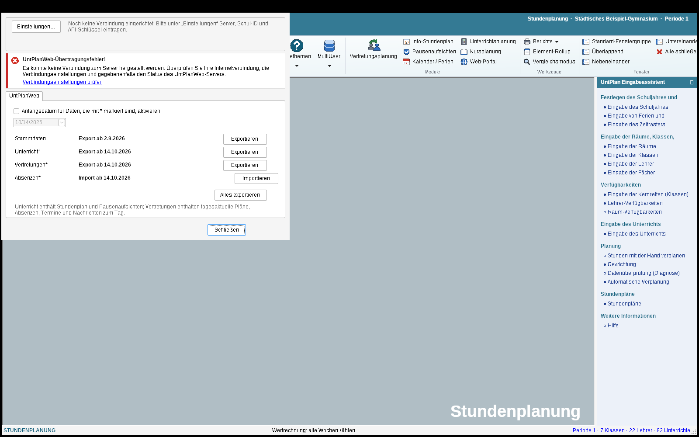

| Zeile | Inhalt |
|---|---|
| Stammdaten | Schule, Zeitraster, Klassen, Lehrer, Räume, Fächer, Ferien |
| Unterricht* | Perioden mit Unterricht und Stundenplan, Pausenaufsichten |
| Vertretungen* | tagesaktuelle Pläne, Vertretungen, Absenzen, Termine, Nachrichten zum Tag |
| Absenzen* (Import) | Krankmeldungen und Nachrichten aus UntPlanWeb |
| Buchungen* (Import) | Raumbuchungen aus UntPlanWeb, je Stunde eine Zeile der Art *Raumbuchung*; nur wenn der Raum frei ist |
| Klausuren* (Import) | Klausuren aus UntPlanWeb mit Klassen, Aufsichten und Räumen; der Unterricht der Klassen entfällt. Führt die Lehrkraft des Unterrichts selbst Aufsicht, ersetzt die Klausur ihn (eine Zeile *Klausur* je Stunde). Erneuter Import aktualisiert nur, eine bestehende Raumbuchung derselben Zeit wird zur Klausur |

- Jeder Teil lässt sich einzeln exportieren; UntPlanWeb ersetzt nur die übertragenen Teile. *Alles exportieren* überträgt alles.
- Mit * markierte Daten gelten ab heute oder ab dem aktivierten Anfangsdatum.
- Schlägt die Übertragung fehl, erscheint oben ein Hinweis mit dem Grund und einem Link zu den Verbindungseinstellungen.
- **Einstellungen:** Schul-ID, Server, Port, https, API-Schlüssel, Tage voraus und *Verbindung prüfen*.
- **Optionen:** ignorierten Unterricht übertragen, Ferien nicht als Stammdaten exportieren, E-Mail-Adressen, Lehrer-Absenzen, Absenzgründe (vertrauliche Gründe nie).
- *Paket als Datei exportieren* erzeugt das Paket offline als JSON-Datei.
- Schema und Schnittstelle stehen in [UNTPLANWEB.md](UNTPLANWEB.md).

**WebPortal** (*Module → Web-Portal*): Tragen Sie Adresse, Schul-ID und API-Schlüssel ein. **Synchronisieren** lädt Stundenplan, Vertretungen, Tagestexte und Ferien hoch und übernimmt Krankmeldungen aus dem Portal als Abwesenheiten.
Die Schnittstelle ist in [SYNC_API.md](SYNC_API.md) beschrieben.

---

## 11. Tastenkürzel

| Taste | Funktion |
|---|---|
| F1 | Hilfe zum aktiven Fenster |
| Strg+N / Strg+O / Strg+S | Neu / Öffnen / Speichern |
| Strg+Z / Strg+Y | Rückgängig / Wiederholen |
| Strg+P | Drucken |
| Strg+M | Stundenplanung ↔ Vertretungsplanung |
| Strg+T | Vertretungen |
| Strg+G | Vertretungsvorschlag |
| + / - (Vertretungsfenster) | Vertretung ohne Lehrkraft / Entfall |
| Entf | Element löschen bzw. Stunde entplanen |
| F | markierte Stunde fixieren / Fixierung lösen |
| Doppelklick auf Kurzname | Umbenennen |
| Strg+Ziehen eines Feldes | Feld aus der Rasteransicht entfernen |

---

## 12. MultiUser

Im MultiUser-Betrieb arbeiten mehrere Planer gleichzeitig mit denselben Daten. Statt in einer Datei `*.up` liegen alle Daten in einer gemeinsamen Datenbank, gegliedert nach **Schule → Schuljahr (JJJJ/JJJJ) → Version** (Nummer und Bezeichnung). Alle Arbeitsplätze müssen dieselbe UntPlan-Version verwenden.

### Einrichtung (MultiUser-Assistent)

| Schritt | Inhalt |
|---|---|
| 1. Datenbanksystem | **SQLite** (Datei, z. B. auf einem Netzlaufwerk – für kleine Schulen), **Microsoft SQL Server / Express**, **MySQL / MariaDB** oder **Microsoft Access** (nur Windows, ACE-Treiber erforderlich) |
| 2. Verbindung | Datei bzw. Server, Port, Datenbank, Datenbank-Benutzer und -Passwort; bei SQL Server wahlweise Windows-Authentifizierung. **Verbindung testen** prüft die Angaben; „Datenbank anlegen, falls sie noch nicht existiert" erstellt eine leere Datenbank. |
| 3. Datenbank einrichten | Beim ersten Verbinden legt UntPlan alle Tabellen an (versioniertes Schema). Hier stellen Sie auch die **automatische Abmeldung** nach X Minuten Inaktivität ein. |
| 4. Administrator-Passwort | Der Benutzer **Administrator** (Gruppe Administrator) wird ohne Passwort angelegt und kann nicht gelöscht werden. Vergeben Sie sofort ein Passwort. |
| 5. Erste Version | Optional wird die geöffnete Schuldatei als erste Version hochgeladen (Schulnummer, Schuljahr, Versionsnummer, Bezeichnung). |

Die Verbindungsdaten werden je Windows-Benutzer in `%APPDATA%\UntPlan\multiuser.json` gespeichert; das Datenbank-Passwort ist mit Windows-DPAPI verschlüsselt.

### Anmelden

Im Anmeldedialog wählen Sie **Schulnummer**, **Schuljahr** und **Version** und geben **Benutzer** und **Passwort** ein. Über den Eintrag **&lt;Neu&gt;** legen Sie eine neue Schule, ein neues Schuljahr oder eine neue Version an (Recht „Schule/Schuljahr/Version anlegen" nötig; eine neue Version entsteht als Kopie der letzten Version oder aus der geöffneten Schuldatei). Mit **Passwort ändern** ändern Sie Ihr eigenes Passwort. Benutzer ohne Passwort werden nach der Anmeldung zur Vergabe aufgefordert.

Anmeldung über die Befehlszeile: `UntPlan.exe DB~123456~2024-2025~1 /user=Meier /pw=geheim`.

### Arbeiten im MultiUser-Betrieb

- **Kein Speichern nötig:** Jede Änderung wird sofort einzeln in die Datenbank geschrieben.
- **Gleichzeitige Änderungen:** Der erste Schreiber gewinnt. Hat ein anderer Benutzer die Daten inzwischen geändert, erscheint „Die Änderung konnte nicht durchgeführt werden, da ein anderer Benutzer die Daten inzwischen geändert hat." – die Daten werden neu geladen, die Eingabe ist zu wiederholen.
- **Fremde Änderungen** werden etwa alle 10 Sekunden erkannt und automatisch angezeigt; **Neuanzeige** lädt sofort neu.
- **Exklusivbetrieb** ist nur möglich, wenn kein anderer Benutzer an der Version angemeldet ist. Er wird für Datenimport, Schuldaten/Zeitraster, Perioden, Ferien und den Wechsel in ein neues Schuljahr empfohlen. Während des Exklusivbetriebs kann sich niemand sonst anmelden.
- **Datei in Datenbank speichern** schreibt die geöffneten Daten oder eine `*.up`-Datei als neue Version bzw. überschreibt eine vorhandene Version. **Version als Datei exportieren** erzeugt eine Schuldatei (z. B. zur Sicherung).
- **Automatische Abmeldung:** Nach der eingestellten Zeit ohne Aktivität fragt UntPlan „Sitzung beenden?" und meldet nach 10 Sekunden ab.

### Benutzerverwaltung

Die Benutzerverwaltung (Recht „Benutzerverwaltung") hat drei Karteikarten:

| Karteikarte | Inhalt |
|---|---|
| Benutzer | Name, Gruppe, letztes Login, Abteilung (Einschränkung auf eine Abteilung), Passwort setzen/löschen |
| Gruppen und Rechte | Ja/Nein-Rechte: Schule/Schuljahr/Version anlegen, Administrator, Benutzerverwaltung, Optimierung, Drucken, Vertretungsstatistik, Web-Export, Datenimport/-export, Info-Stundenplan. Stufen *Keine / Nur lesen / Ansichten bearbeiten / Bearbeiten* für Stundenplan, Stammdaten, Besondere Daten, Unterricht, Perioden, Vertretungsplanung, Absenzen, Kursplanung und Anrechnungen. Vorgegeben sind die Gruppen Administrator, Stundenplaner, Vertretungsplaner und Info. |
| Einschränkungen | Je Gruppe: Schule, Schuljahr, Version, Periode, Abteilung, Nur lesen. Leere Felder gelten für alle; hat eine Gruppe Einschränkungen, ist die Anmeldung nur an passenden Versionen möglich. |

Änderungen, für die das Recht fehlt, werden nicht gespeichert; die Daten werden neu geladen.

### Angemeldete Benutzer und Nachrichten

**Angemeldete Benutzer** zeigt alle Sitzungen mit Rechner, Version, Anmeldezeit, letzter Aktivität und aktueller Tätigkeit (aktives Fenster). Sie können eine **Nachricht an alle** oder an einen Benutzer senden; sie erscheint beim Empfänger innerhalb von 10 Sekunden. Administratoren können Benutzer **abmelden**.

---

## 13. Bedienung: Tabellen, Suche, Formate

- **Ein Klick genügt:** Ein Klick in ein änderbares Tabellenfeld startet die Bearbeitung.
- **Suche in Auswahllisten:** In allen Auswahllisten, auch in Tabellen, können Sie tippen. Die Liste öffnet sich und markiert den besten Treffer; es gibt keine zusätzliche Vorschlagsliste.
  - Gesucht wird im Kurz- und im Langnamen.
  - Enter oder Verlassen des Feldes übernimmt den Eintrag.
  - Neben dem Kurznamen steht grau der Langname.
  - Die Liste öffnet immer nach unten.
- **Spaltenformatierung:** Ein Rechtsklick auf einen Spaltenkopf öffnet das Formatmenü.
  - **Spalten ein-/ausblenden** über eine Liste, die beim Anklicken offen bleibt.
  - **Spalten anpassen…** öffnet einen Dialog: Zeigen, Reihenfolge (▲ ▼), eigene Überschrift, Breite, Ausrichtung, Fixieren (bleibt beim waagerechten Blättern stehen).
  - **Spaltenbreiten an Inhalt anpassen.**
  - **Tabellenformat:** eigene Formate speichern, wechseln, löschen; Standard wiederherstellen.

  Jede Änderung, auch Verschieben und Verbreitern mit der Maus, wird sofort gemerkt und gilt nach jedem Neuaufbau und beim nächsten Öffnen. Ausgeblendete Spalten bleiben ausgeblendet.
- **Druckformat-Editor:** Vor der Seitenansicht einer Liste öffnet sich das *Druckformular*. Dort legen Sie fest:
  - Überschrift, Fußzeile und Summenzeile.
  - Schriftgröße und Hoch- oder Querformat.
  - Gitterlinien und Zebrastreifen.
  - Welche Spalten mit welcher Breite gedruckt werden.

  Jede Liste merkt sich ihr eigenes Drucklayout.
