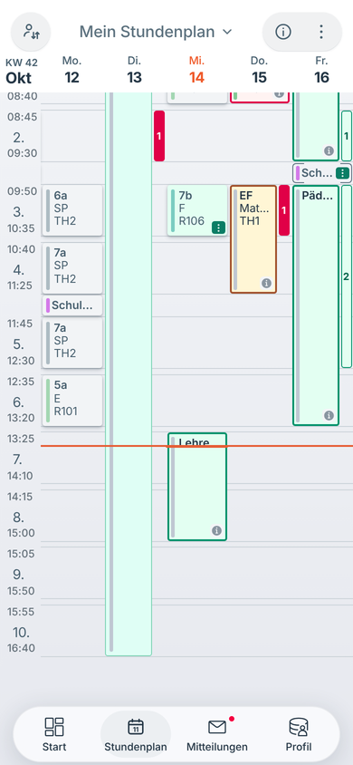
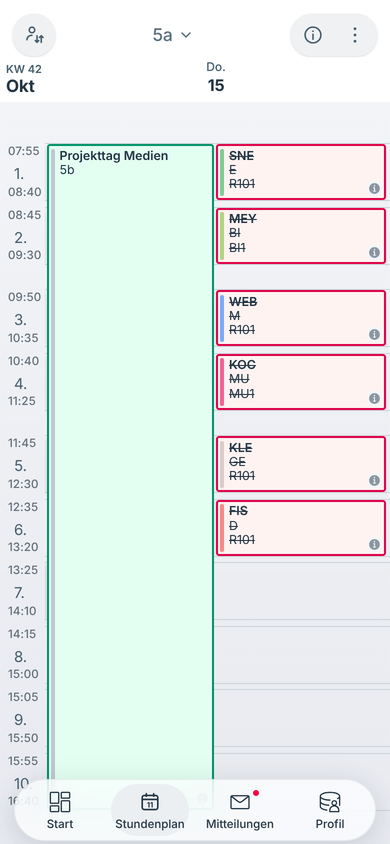
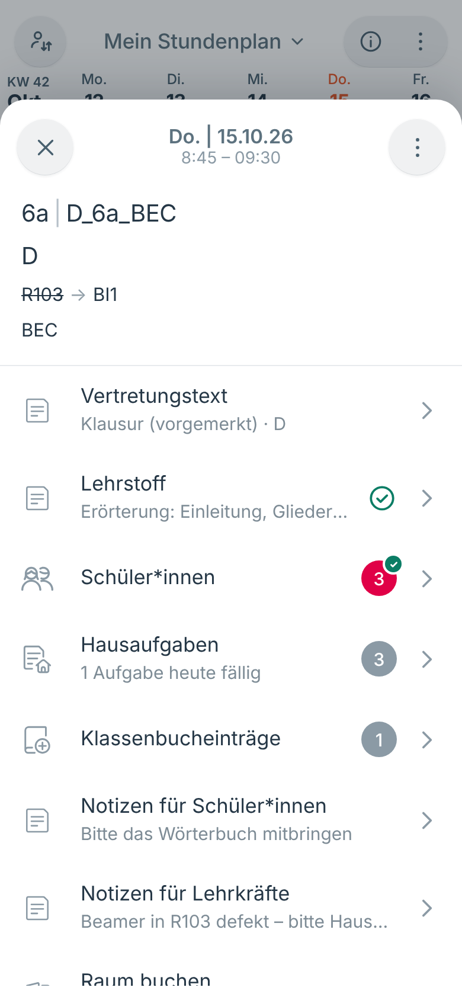
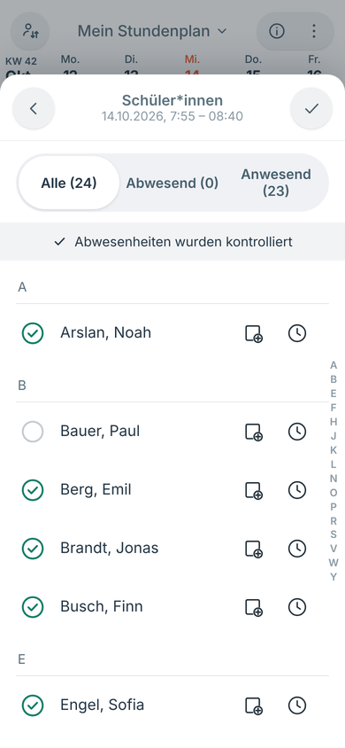
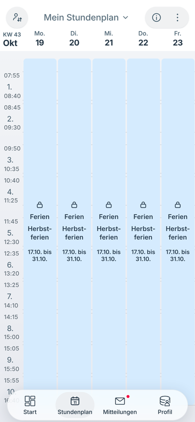
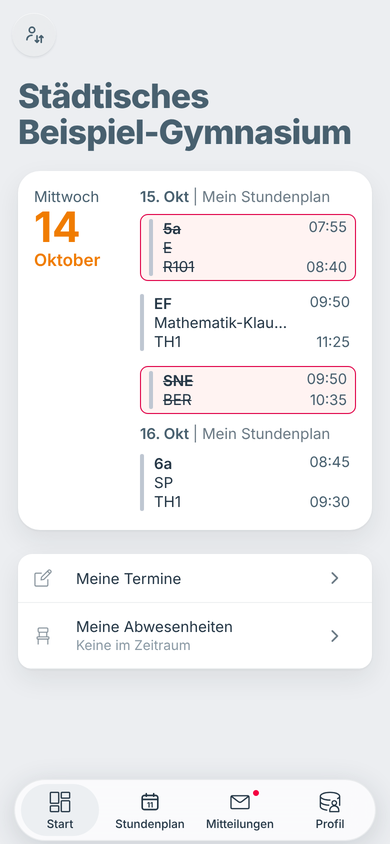
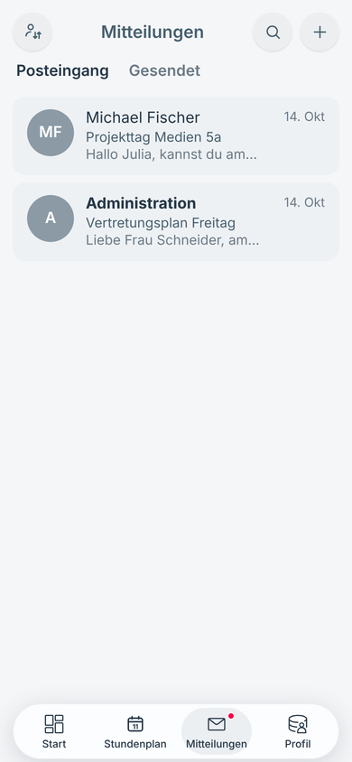
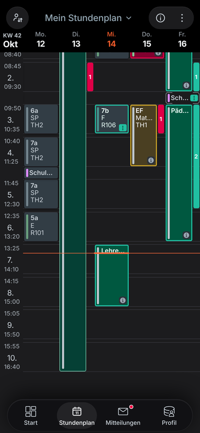
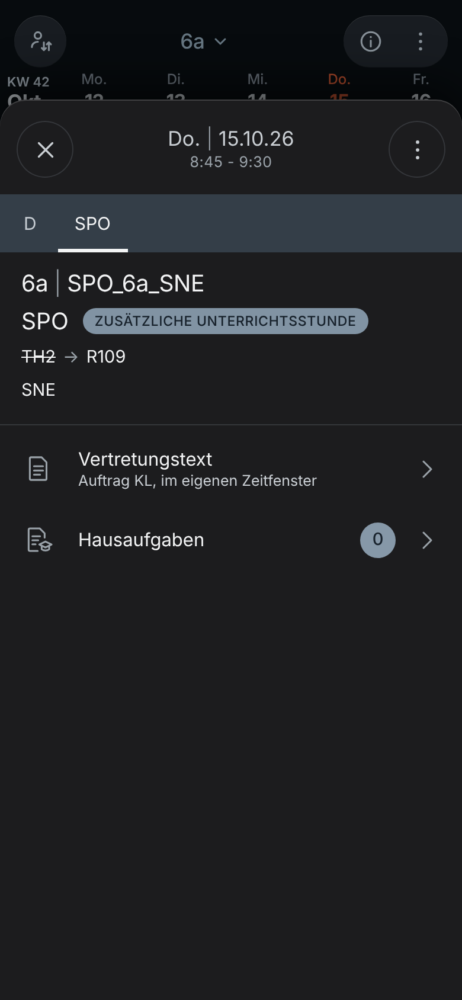
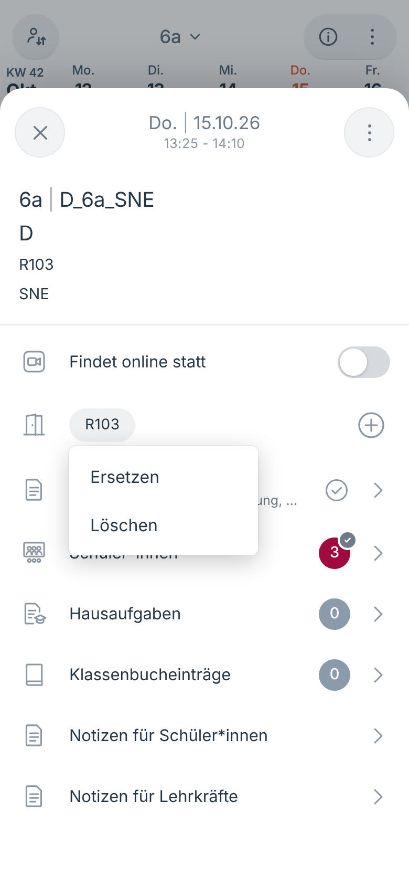

# UntPlanMobile

**Der Stundenplan fürs Telefon – als installierbare App (PWA) zu UntPlanWeb.**
UntPlanMobile zeigt Stundenpläne, Vertretungen, Ferien und Termine in der vertrauten Vorbild-Optik, führt das Klassenbuch
der eigenen Stunden und bringt die Mitteilungen aus UntPlanWeb aufs Telefon. Die App hat keine eigene Datenbank: Sie
holt alles von einer laufenden UntPlanWeb-Instanz, angemeldet wird mit dem Konto von UntPlanWeb.

| Klassenplan | Lehrerplan | Tagesansicht | Stundendetails |
|---|---|---|---|
|  |  |  |  |

| Anwesenheit | Ferien | Startseite | Mitteilungen | Dunkel |
|---|---|---|---|---|
|  |  |  |  |  |

| Zusatzstunde | Raum-Chip | Raumliste |
|---|---|---|
|  |  |  |

## Funktionen

- **Stundenplan** für den eigenen Plan, Klassen, Lehrkräfte und Räume:
  - Zeitproportionales Raster mit Pausen, Jetzt-Linie und Öffnen an der aktuellen Uhrzeit.
  - Kacheln mit Fachfarbe als Balken: Änderungen grün mit Plakette am geänderten Wert, offene Vertretungen mit
    durchgestrichenem Kürzel, Entfall rot und durchgestrichen, Klausuren gelb, Veranstaltungen grün gerahmt,
    Bereitschaften gestrichelt, Pausenaufsichten als Pillen in der Pause.
  - Im eigenen Lehrerplan laufen abgegebene Stunden „ohne mich“ weiter (Eckklammern).
  - Ferien und Feiertage als blaues Feld mit Name und Zeitraum, ganztägige Termine als Pille über der ersten Stunde.
  - Parallele Stunden mit Zählkarte, Tippen öffnet den Tag mit allen Stunden nebeneinander. Gekoppelte Stunden mit
    unterschiedlichen Fächern sind eigene Kacheln; nur bei gleichem Fach und Raum stehen alle Lehrkräfte und Klassen auf einer.
  - Trennzeichen: Auf den Kacheln stehen mehrere Werte (Lehrkräfte – auch bei Veranstaltungen –, Klassen, Räume) durch
    **Kommas** getrennt, in den Stundendetails durch „ | “. Nur die Lehrerleiste rollt waagerecht, der Rest der Kachel
    bleibt stehen. Zu lange Werte und Plaketten enden mit „…“.
  - Offene Raumvertretungen (Raumänderung ohne neuen Raum, Platzhalter „???“) wie offene Lehrervertretungen: bisheriger
    Raum durchgestrichen in der Plakette, in den Details Plakette „RAUM OFFEN“.
  - Abwesende Klasse (Freisetzung): kein Entfall – im Klassenplan grüne Kachel mit der Klasse durchgestrichen in der Plakette
    (oberste Zeile), im Lehrer- und Raumplan wie eine abgegebene Stunde (Eckklammern, Klasse durchgestrichen). Nur ein
    echter Entfall bleibt rot.
  - Veranstaltungen laufen als ein Block über Pausen mit Aufsicht hinweg; die Aufsicht tritt in der Wochenansicht dahinter
    zurück und steht in der Tagesansicht als halbe Kachel daneben.
  - Zusatzstunden (Sondereinsatz, Zusatzunterricht, Verlegung …) ohne Lehrkraft zeigen „---“ als Lehrkraft – nur bei
    Zusatzstunden, auf der Kachel und in den Details. Vertretungen ohne Lehrkraft („+++“) behalten die durchgestrichene
    bisherige Lehrkraft und den Hinweis „Vertr. o. Lehrkr.“.
  - Info-Zeichen unten rechts bei Notizen (für Schüler*innen bzw. Lehrkräfte) und Vertretungstext, Hausaufgabenzeichen in der
    Stunde, zu der eine Hausaufgabe fällig ist.
  - Wischen zwischen Wochen bzw. Tagen (Nachbarwochen vorgeladen), Tagesansicht, „Gehe zu Datum“, Legende.
  - Auswahl mit Kategorien, Buchstabenleiste und Suche; Klassenkonten sehen nur die eigene Klasse und Räume.
- **Stundendetails** nach den Mobile-Sollbildern (im Dunkeln wie die Portal-Fotos, im Hellen gleich aufgebaut), mit
  Sprung in die Pläne von Klasse, Lehrkraft und Raum (⋮-Menü):
  - Kopf mit X, Datum „Fr. | 16.10.26“ und kleiner Uhrzeit, ⋮-Menü. Liegen mehrere Stunden im selben Zeitraum, führen
    obere Reiter mit den Fachkürzeln zu jeder (Veranstaltung als Reiter „Veranstaltung“ vorn).
  - Kopfblock „Klasse | Kursbezeichnung“, Fach mit Plakette „ZUSÄTZLICHE UNTERRICHTSSTUNDE“ bzw. „VERANSTALTUNG“, alter Raum
    durchgestrichen → neuer Raum, Lehrkraft; bei Entfall grau hinterlegt mit rotem Band „ENTFÄLLT“.
  - Aktionszeilen mit Symbol, Titel, Untertitel, Zähler und „>“: Findet online statt (Schalter), Raum, Vertretungstext bzw.
    Information zur Stunde, Lehrstoff (Häkchen, wenn eingetragen), Schüler*innen (rotes Feld mit der Zahl der Abwesenden,
    Häkchen nach der Kontrolle), Hausaufgaben, Klassenbucheinträge, Notizen für Schüler*innen und für Lehrkräfte.
    Klassenbuchzeilen gibt es nur für die eigene Stunde mit Unterricht; fremde Stunden, Zusatzstunden ohne Unterricht und
    Veranstaltungen zeigen wie in den Sollbildern nur Vertretungstext/Information, Hausaufgaben und vorhandene Notizen.
  - **Raumbuchung mobil:** Jeder Raum steht als Chip; Tippen öffnet „Ersetzen“/„Löschen“, das „+“ rechts fügt einen
    zusätzlichen Raum hinzu. Ersetzen und Hinzufügen führen in die Raumliste („R103 ersetzen“) mit Suchfeld und Filterpille
    „Abteilung“ (Raumart); angeboten werden die freien buchbaren Räume. Die Änderung steht sofort im Plan (vorgemerkt, bis
    UntPlan sie übernimmt). Der letzte Raum einer Stunde lässt sich nicht löschen – nur ersetzen.
  - **Schüler*innen:** Filter-Pillen Alle/Abwesend/Anwesend mit Zahlen, Band „✓ Abwesenheiten wurden kontrolliert“,
    alphabetische Gruppen („Nachname Vorname“) mit Buchstabenleiste rechts, Statuskreis grün/rot, Zusatz (Klassendienst wie
    Klassensprecher*in, „Abwesend (fehlt)“), rechts Klassenbucheintrag (Buch, mit Plus wenn noch keiner) und Uhr
    (Abwesenheit bearbeiten). Antippen des Kreises oder Wischen setzt „abwesend“ bzw. „verspätet“; der Besen oben rechts
    markiert alle als anwesend. Hinweis-Karte „Klassenbucheintrag – Tippen Sie mehrere Schüler*innen an, um einen
    gemeinsamen Eintrag zu erstellen.“: Die Buch-Symbole wählen aus, die Leiste unten legt den gemeinsamen Eintrag an.
  - Lehrstoff, Hausaufgaben mit Fälligkeit und Bemerkung (Hausaufgabenliste von UntPlanWeb), *Notizen für Schüler*innen*
    (Klassenkonten lesen sie), *Notizen für Lehrkräfte*, Klassenbucheinträge (Vermerke zur Klasse).
  - Hausaufgaben, die zu einer Stunde fällig sind, tragen ein Zeichen auf der Kachel.
- **Startseite:** die nächsten Stunden des eigenen Plans, Termine und Klausuren der nächsten zwei Wochen, eigene
  Abwesenheitsmeldungen; für Klassenleitungen die Fehlzeiten der Klasse mit „Entschuldigen“ und „Ablehnen“.
- **Mitteilungen:** Posteingang und Gesendet, Lesen, Antworten, Schreiben (Empfänger, Gruppen und Klassen wie in
  UntPlanWeb), Löschen.
- **Profil:** Erscheinungsbild Automatisch/Hell/Dunkel, Zeiten auf den Karten, entfallene Stunden ein-/ausblenden,
  Daten aktualisieren, Fassung, Abmelden.
- **Offline:** Der Service Worker hält die App und die zuletzt geladenen Wochen vor. Jede neue Fassung erneuert den
  Cache auf den Geräten automatisch (Prüfwert über alle Dateien der Oberfläche).

Nicht in der App (nur in UntPlanWeb): Entwürfe und Anhänge bei Mitteilungen, Abwesenheitsgründe und
„Erziehungsberechtigte benachrichtigt“, mehrere Profile auf einem Gerät. Klassenkonten sehen in UntPlanWeb keine Fehlzeiten einzelner Schüler*innen – „Meine Abwesenheiten“ bleibt
dort leer.

## Installation mit Docker

UntPlanMobile läuft neben UntPlanWeb, als eigener Container auf **Port 8081**. Die Datei `docker-compose.yml` startet beide:

```bash
mkdir untplan && cd untplan
curl -O https://raw.githubusercontent.com/florians25/UntPlan/main/mobile/docker-compose.yml
docker compose up -d
```

- UntPlanWeb: `http://<server>:8080` – Schule einrichten, UntPlan verbinden, Konten anlegen (siehe [UntPlanWeb](../web/README.md)).
- UntPlanMobile: `http://<server>:8081` – mit einem Konto von UntPlanWeb anmelden.

**Ausprobieren mit Beispieldaten:** In `docker-compose.yml` bei UntPlanWeb `UNTPLANWEB_DEMO: "1"` und
`UNTPLANWEB_ADMIN_PASSWORT: "admin12345"` setzen. Konten für Lehrkräfte und Klassen legt UntPlanWeb unter
*Administration → Benutzer → Konten aus Stammdaten* an.

**Läuft UntPlanWeb schon** (z. B. mit der Compose-Datei aus `web/`), genügt UntPlanMobile allein:

```bash
docker run -d --name untplanmobile -p 8081:8081 -e UNTPLANWEB_URL=http://<server>:8080 ghcr.io/florians25/untplanmobile
```

**Selbst bauen** (Wurzel des UntPlan-Repositorys): `docker build -f mobile/Dockerfile -t untplanmobile .`

### Als App installieren (HTTPS)

Service Worker und „Zum Home-Bildschirm“ funktionieren nur über HTTPS (oder `localhost`). Im Betrieb gehört
UntPlanMobile deshalb hinter einen Reverse-Proxy mit Zertifikat, zum Beispiel Caddy:

```
plan.meine-schule.de {
    reverse_proxy untplanweb:8080
}
app.meine-schule.de {
    reverse_proxy untplanmobile:8081
}
```

UntPlanMobile wertet `X-Forwarded-Proto` und `X-Forwarded-Host` aus und setzt das Sitzungscookie dann als `Secure`.

### Einstellungen (Umgebungsvariablen)

| Variable | Bedeutung | Standard |
|---|---|---|
| `UNTPLANWEB_URL` | Adresse von UntPlanWeb aus Sicht des Containers | `http://untplanweb:8080` (Image), `http://localhost:8080` (Entwicklung) |
| `UNTPLANWEB_PUBLIC_URL` | Adresse von UntPlanWeb aus Sicht des Browsers (für die Einmalanmeldung) | gleicher Rechnername, Port 8080 |
| `UNTPLANMOBILE_ZEITZONE` | Zeitzone der Schule (heutiger Tag, aktuelle Woche) | `Europe/Berlin` |
| `ASPNETCORE_HTTP_PORTS` | Port im Container | `8081` |
| `UNTPLANMOBILE_UPDATE_PRUEFEN` | `0` = nicht nach neuen Versionen suchen | an |
| `UNTPLANMOBILE_UPDATE_URL` | Quelle der neuesten Version (wie `UNTPLANWEB_UPDATE_URL`, z. B. `ghcr://florians25/untplanmobile`) | GitHub-Releases von florians25/UntPlan |
| `UNTPLANMOBILE_UPDATE_TAG_PRAEFIX` | nur Tags mit diesem Präfix berücksichtigen | – |

### Installation mit MariaDB/MySQL

UntPlanMobile selbst speichert keine Daten – es ist ein Proxy vor UntPlanWeb. Die Datenbank betrifft nur UntPlanWeb;
`docker-compose.mariadb.yml` startet MariaDB (Volume, Healthcheck), UntPlanWeb mit `UNTPLANWEB_DB=mysql` und UntPlanMobile:

```bash
mkdir untplan && cd untplan
curl -O https://raw.githubusercontent.com/florians25/UntPlan/main/mobile/docker-compose.mariadb.yml
curl -O https://raw.githubusercontent.com/florians25/UntPlan/main/mobile/update.sh && chmod +x update.sh
printf 'MARIADB_PASSWORT=…\nMARIADB_ROOT_PASSWORT=…\nWATCHTOWER_TOKEN=…\nCOMPOSE_FILE=docker-compose.mariadb.yml\n' > .env
docker compose up -d
```

Einzelheiten (eigener Datenbankserver, Verbindungszeichenfolge, Technik): [UntPlanWeb – Installation mit MariaDB/MySQL](../web/README.md#installation-mit-mariadbmysql).

### Update

Wie bei UntPlanWeb ist ein Update ein neues Image; UntPlanMobile hat keine Migrationen und keinen Zustand außer den Sitzungen,
die an UntPlanWeb hängen. Beide Dienste zusammen aktualisieren:

```bash
./update.sh                       # Sicherung von UntPlanWeb (SQLite bzw. MariaDB), docker compose pull, docker compose up -d
# oder von Hand:
docker compose pull && docker compose up -d
```

- **Versionsanzeige:** `GET /api/version` liefert Version, neueste veröffentlichte Version und ob ein Update verfügbar ist
  (gleiche Prüflogik wie UntPlanWeb, Datei `web/src/UntPlanWeb/Dienste/Updatepruefung.cs` wird eingebunden). Mit
  `UNTPLANWEB_MOBILE_INTERN_URL=http://untplanmobile:8081` bei UntPlanWeb (in den Compose-Dateien gesetzt) erscheint die Version von
  UntPlanMobile auch in UntPlanWeb unter *Administration → Übersicht → Version & Updates*.
- **Update aus der Oberfläche:** UntPlanMobile hat keine eigene Administration. Der Knopf *Update installieren* in UntPlanWeb
  stößt Watchtower an (`docker compose --profile updater up -d`), das alle Container mit dem Label
  `com.centurylinklabs.watchtower.enable=true` aktualisiert – also UntPlanWeb und UntPlanMobile, nicht MariaDB. Alternativ
  Anforderungsdatei plus cron (`./update.sh --wenn-angefordert`), siehe [UntPlanWeb – Update](../web/README.md#update).
- Nach dem Update lädt die App auf den Telefonen die neue Oberfläche automatisch: Der Service Worker trägt eine Fassung
  (Prüfwert über alle Dateien) im Cachenamen.

### Datenmigration

UntPlanMobile hat keine eigenen Daten. Für den Umstieg von UntPlanWeb von SQLite auf MariaDB im selben Ordner:

```bash
docker compose down
curl -O https://raw.githubusercontent.com/florians25/UntPlan/main/mobile/docker-compose.mariadb.yml   # .env wie oben
docker compose -f docker-compose.mariadb.yml run --rm untplanweb --migrieren-nach-mysql
docker compose -f docker-compose.mariadb.yml up -d
```

Siehe [UntPlanWeb – Datenmigration](../web/README.md#datenmigration).

## Verbindung zu UntPlanWeb

UntPlanMobile spricht ausschließlich die JSON-API von UntPlanWeb (`/api/app/*`) an:

- **Anmeldung:** `POST /api/login` gibt Benutzername und Passwort an `POST /api/app/anmelden` weiter. Das Sitzungscookie
  von UntPlanWeb bekommt der Browser als eigenes Cookie `untplanmobile` (HttpOnly, SameSite=Lax); UntPlanMobile reicht
  es bei jedem Aufruf als `untplanweb` weiter und führt Erneuerungen und Abmeldungen nach. Ändernde Aufrufe tragen den
  Kopf `X-UntPlanWeb: 1`, den UntPlanWeb verlangt. Ohne gültige Sitzung antworten alle Endpunkte mit HTTP 401, die
  App zeigt dann die Anmeldung.
- **Rechte** prüft allein UntPlanWeb (z. B. Lehrerpläne nicht für Klassenkonten, Klassenbuch nur für die eigene Stunde);
  dessen Fehlermeldungen kommen unverändert in der App an.

| UntPlanMobile | Aufgabe | UntPlanWeb |
|---|---|---|
| `GET /` | App-Hülle mit Startdaten (`window.TT_BOOT`: eigener Plan, Stammdaten, aktuelle Woche) | `sitzung`, `elemente`, `plan` |
| `GET /api/mobile?action=meta` | eigener Plan, Klassen/Lehrkräfte/Räume, Stundenzeiten, Langnamen | `sitzung`, `elemente` |
| `GET /api/mobile?action=week&date=…&type=mine\|class\|teacher\|room&id=…` | eine Woche als Kacheln | `plan`, `klassenbuch/klasse` |
| `POST /api/login` (`action=login\|logout`) | An- und Abmelden | `anmelden`, `abmelden` |
| `GET/POST /api/classbook` | Lehrstoff, Hausaufgaben, Notizen für Schüler*innen und Lehrkräfte, Klassenbucheinträge, Bemerkungen, Anwesenheit, Klassendienste, „Findet online statt“ (`action=online`), gemeinsamer Klassenbucheintrag (`action=remarkMany`); `canEdit` sagt, ob es die eigene Stunde ist | `klassenbuch/stunde`, `klassenbuch/hausaufgabenliste`, `klassenbuch/anwesenheit`, `klassenbuch/vermerke`, `klassenbuch/klasse`, `klassendienste`, `klassenbuch/online` |
| `GET/POST /api/rooms` (`action=free\|book\|change`) | freie buchbare Räume einer Stunde, Raum buchen; `change` mit `op=replace\|add\|remove` (Raum-Chip) | `meldungen/freieraeume`, `meldungen/raumbuchung`, `mobil/raum` |
| `GET/POST /api/home` | Startseite, Termine, Abwesenheiten, Fehlzeiten der Klasse, Entschuldigen | `heute`, `meldungen`, `klassenbuch/fehlzeiten` |
| `GET/POST /api/messages` | Posteingang, Gesendet, Lesen, Schreiben, Löschen | `mitteilungen` |
| `GET /api/accounts` | Profilwechsel (nicht unterstützt, leere Liste) | – |
| `GET /sw.js`, `/manifest.webmanifest`, `/assets/…` | Service Worker (mit Fassung), Manifest, Oberfläche | – |
| `GET /gesundheit` | Gesundheitsprüfung (Docker) | – |

**Übersetzung der Karten:** Die Stundenkarten von UntPlanWeb werden in die Kacheln der Oberfläche übersetzt
(`Dienste/Kachelbau.cs`):

| UntPlanWeb | Kachel |
|---|---|
| `regulaer` | `normal` |
| `geaendert`, `vorgemerkt` | `change` (geänderte Werte mit `…Orig` und `changed`) |
| `geaendert` als Zusatzstunde (Sondereinsatz, Zusatz…, Verlegung, ohne Unterricht) | `change` mit `extra` (Plakette in den Details), ohne Lehrkraft `teacher: "---"` |
| `offen` | `change` mit `openSub` (alter Wert durchgestrichen) |
| `abwesend` (Lehrer-/Raumplan) | `change` mit dem eigenen Kürzel als `teacherOrig` (läuft ohne mich) |
| `entfall` | `cancelled` |
| `entfall` mit Art Freisetzung/Klassenabwesenheit | `change` mit `classAbsent` (Klasse als `classOrig`) |
| Raumänderung ohne neuen Raum, Raum „???“ | `openRoom` (bisheriger Raum als `roomOrig`) |
| `klausur` | `klausur` |
| `bereitschaft` | `standby` (Stunden mit gehaltener Vertretung entfallen) |
| `veranstaltung`, Teilnahme ohne Fach | `absence` mit `overlay` (grün gerahmtes Feld) |
| `buchung` | `event` |
| freier Tag (`ferien`, `feiertag`, `frei`) | `holiday` mit `holidayName` und `holidayRange` |
| Pausenaufsicht | `supervision` (`_supAbsent` vertreten, `_supSub` übernommen) |

Für die Zeiträume der Ferienfelder liefert UntPlanWeb unter `/api/app/elemente` zusätzlich die Liste `ferien`.

**Raumänderung aus der App** (`POST /api/app/mobil/raum` in UntPlanWeb, `Api/MobilApi.cs`): ersetzen, hinzufügen oder
löschen. Gespeichert wird wie jede Raumbuchung als Rückmeldung „raumbuchung“ mit der vollständigen Raumliste (neuer Raum
vorn – UntPlan übernimmt ihn als Vertretungsraum, die übrigen als Zusatzräume). Je Lehrkraft und Stunde gibt es höchstens
eine offene Raumänderung; ergibt sich wieder die ursprüngliche Raumliste, wird sie nur zurückgezogen. Neue Räume müssen
buchbar und frei sein.

## Mehrere Profile und Benachrichtigungen (Web-Push)

- **Mehrere Profile je Gerät:** Unter „Profil → Weiteres Profil anmelden“ meldet sich ein weiteres Konto an, ohne das bisherige abzumelden. Gewechselt wird über das Personensymbol oben links. Die Sitzungen liegen verschlüsselt (ASP.NET Data Protection) im Datenordner von UntPlanMobile; das Gerät trägt nur eine Zufallskennung als Cookie. „Abmelden“ meldet nur das aktuelle Profil ab.
- **Benachrichtigung sofort nach dem Import:** UntPlanMobile prüft jede Minute (`UNTPLANMOBILE_PUSH_INTERVALL`, Sekunden, `0` = aus) den Planstand von UntPlanWeb. Ändert sich der eigene Plan eines Profils mit eingeschalteten Benachrichtigungen, geht ein Web-Push (RFC 8291/8292, eigene Implementierung ohne Fremdbibliothek) an das Gerät. Am iPhone/iPad funktioniert das in der App vom Homescreen ab iOS 16.4; HTTPS ist Voraussetzung.
- **Datenordner:** `UNTPLANMOBILE_DATEN` (im Container `/data`, Volume `untplanmobile-daten`) enthält `konten.json`, `vapid.json` (VAPID-Schlüssel, beim ersten Start erzeugt) und die Data-Protection-Schlüssel. Kontakt für die Push-Dienste: `UNTPLANMOBILE_VAPID_KONTAKT` (`mailto:` oder `https:`).

## Entwicklung

```bash
# UntPlanWeb mit Beispieldaten (Port 5190)
cd web && UNTPLANWEB_DEMO=1 UNTPLANWEB_ADMIN_PASSWORT=admin12345 dotnet run --project src/UntPlanWeb --urls http://localhost:5190
# UntPlanMobile dagegen (Port 5191)
cd mobile && UNTPLANWEB_URL=http://localhost:5190 dotnet run --project src/UntPlanMobile --urls http://localhost:5191
# Tests (starten UntPlanWeb im Testprozess)
dotnet test mobile/tests/UntPlanMobile.Tests
```

Aufbau:

- `src/UntPlanMobile`: ASP.NET Core 8 (Minimal-APIs) ohne eigene Datenbank.
  - `Dienste/UntPlanWebVerbindung.cs`: Aufrufe an UntPlanWeb mit durchgereichtem Sitzungscookie.
  - `Dienste/Kachelbau.cs`: Wochenplan → Kacheln; `Dienste/Wochendienst.cs`: Wochen, Stammdaten, Startdaten.
  - `Api/`: die Endpunkte der Oberfläche (Stundenplan, Anmeldung, Klassenbuch, Startseite, Mitteilungen) und `VersionApi.cs` (`/api/version`).
  - `Vorlagen/index.html`, `Vorlagen/sw.js`: App-Hülle und Service Worker; der Server setzt Symbolsammlung,
    Startdaten (mit CSP-Nonce) und Fassung ein.
  - `wwwroot/`: die Oberfläche ohne Build-Schritt – `app.js`, `app.css`, Symbole und Manifest.
- `tests/UntPlanMobile.Tests`: Übersetzung der Karten und Ende-zu-Ende-Tests gegen UntPlanWeb mit dem Beispielpaket.

Die Oberfläche stammt aus einer Stundenplan-PWA mit PHP-Backend und ist nahezu unverändert übernommen. Angepasst sind
die Endpunkte (`api/mobile` usw. statt der PHP-Dateien), der Name, Langnamen und Kategorien aus UntPlanWeb, ein
Mindestabstand für den Streifen über der ersten Stunde (Schulen mit Fünf-Minuten-Wechseln) und das Ausblenden der
Funktionen, die UntPlanWeb nicht anbietet. Die Druckseite der Vorlage entfällt – gedruckt wird in UntPlanWeb.

UntPlanMobile gehört weder zur Desktop-Solution `UntPlan.sln` noch zu `web/UntPlanWeb.sln`, sondern hat die eigene
Solution `UntPlanMobile.sln` und einen eigenen CI-Ablauf (`.github/workflows/mobile.yml`). Dieser testet und
veröffentlicht das Image `ghcr.io/florians25/untplanmobile`.

> Hinweis: Ein neues GHCR-Paket ist zunächst privat. Damit `docker pull` ohne Anmeldung funktioniert, stellen Sie es einmalig auf öffentlich:
> GitHub → Packages → untplanmobile → Package settings → Change visibility.

## Einmalanmeldung (SSO) über UntPlanWeb

Beim ersten Aufruf leitet UntPlanMobile automatisch zu UntPlanWeb weiter. Wer dort schon angemeldet ist, landet ohne
Passworteingabe direkt im eigenen Plan. Sonst erscheint die Anmeldeseite von UntPlanWeb, danach geht es zurück in die App.
Die Anmeldung mit Benutzername und Passwort in der App bleibt als Alternative erhalten.

- UntPlanWeb gibt nur einen Einmal-Code heraus (2 Minuten gültig), den UntPlanMobile serverseitig einlöst; Passwörter
  laufen nie über die Mobil-App.
- Erlaubte Rücksprungadressen: `UNTPLANWEB_MOBILE_URL` bei UntPlanWeb (kommagetrennt, z. B. `https://m.meine-schule.de`).
  Ohne Angabe ist nur derselbe Rechnername (anderer Port) erlaubt.
- Liegen beide hinter verschiedenen Adressen (Reverse-Proxy), bei UntPlanMobile `UNTPLANWEB_PUBLIC_URL` und bei UntPlanWeb
  `UNTPLANWEB_MOBILE_URL` setzen.
