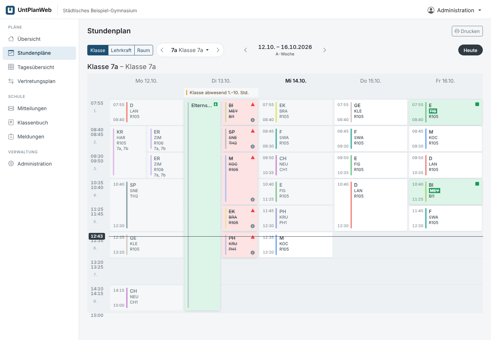
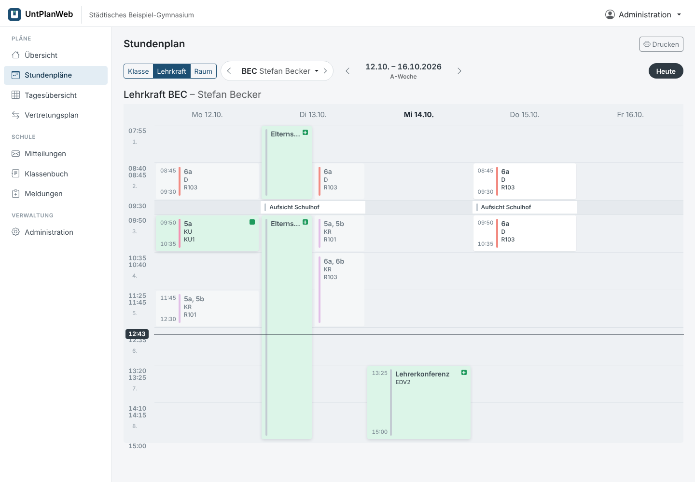
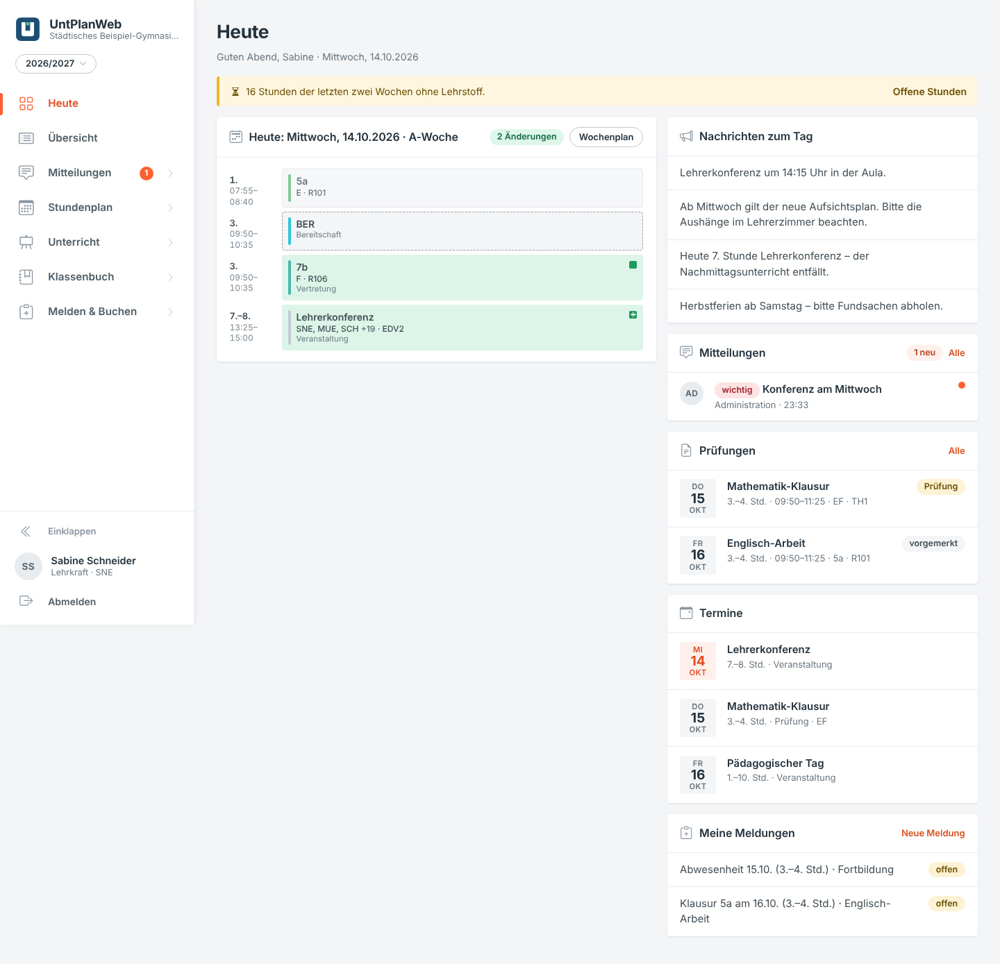
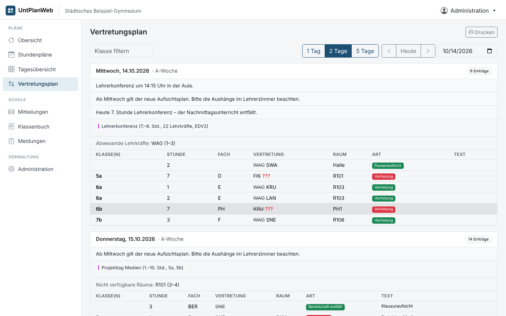

# UntPlanWeb

**Stundenplan, Vertretungsplan und Rückmeldungen im Browser – der Webbegleiter zu UntPlan.**
UntPlan (Desktop) überträgt Stammdaten, Stundenpläne und Vertretungen an UntPlanWeb. Lehrkräfte, Schulleitung und Klassen sehen dort
ihre Pläne auf PC, Tablet und Smartphone. Abwesenheiten, Raumbuchungen und Klausuren, die im Browser eingetragen werden, holt
UntPlan beim nächsten Datenaustausch ab.



## Funktionen

- **Heute:** der nächste Unterrichtstag mit Änderungen, Pausenaufsichten, Nachrichten, Terminen und eigenen Meldungen.
- **Stundenpläne** für Klassen, Lehrkräfte und Räume:
  - Raster nach Unterrichtsstunden mit Uhrzeiten und Jetzt-Linie; gleichzeitige Stunden stehen nebeneinander.
    Pausenzeilen (mit Aufsichten) nur dort, wo in der Woche wirklich eine Pause mit Aufsicht liegt.
  - Leicht abgerundete Stundenkarten mit Beginn/Ende, Akzentbalken in der Fachfarbe aus UntPlan und den bekannten Kennzeichen:
    Änderungen grün hinterlegt, geänderte Werte als grüne Kürzelbox, offene Vertretungen mit durchgestrichenem alten Wert,
    Entfall rot und durchgestrichen, Prüfungen gelb.
  - Ferien, Feiertage und freie Tage als blaue Fläche mit Schloss; Elementwahl mit Vor/Zurück (auch Alt+←/→), Woche mittig, „Heute“.
  - Marker oben rechts (Entfall, Prüfung, Änderung, Zusatzstunde) und Infozeichen bei Zusatztext.
  - Veranstaltungen als grüne Zusatzkarten; Teilnahmen mehrerer Lehrkräfte werden zusammengefasst.
  - Aus den Stundendetails direkt eine Klausur eintragen oder einen freien Raum buchen; beides erscheint sofort auf der Karte
    („Klausur (vorgemerkt)“ bzw. „Raumänderung (vorgemerkt)“).
  - Bereitschaften, Raumbuchungen und Vormerkungen; Druck, Mobilansicht mit Tagesauswahl.
- **Tagesübersicht** (Kollegium): alle Klassen, Lehrkräfte oder Räume eines Tages auf einen Blick.
- **Vertretungsplan** als Schüler- oder Lehrerversion:
  - Die Schülerversion zeigt keine Abwesenheitsgründe und weder Bereitschaften noch Aufsichten.
  - Aufeinanderfolgende Stunden werden zusammengefasst („3–4“).
- **Monitore:** Vertretungsplan für Info-Bildschirme über einen geheimen Link (ohne Anmeldung), mit Uhr, automatischem Bildlauf und minütlicher Aktualisierung.
- **Melden & Buchen** (Lehrkräfte):
  - Abwesenheit melden, freien Raum buchen, Klausur eintragen. Buchbar sind nur Räume, die in UntPlan in den Stammdaten
    als „buchbar (Web)“ markiert sind (ältere Pakete ohne Kennzeichen: alle Räume).
  - Die Meldungen gehen als Rückmeldungen an UntPlan; Buchungen erscheinen sofort als „vorgemerkt“.
- **Klassenbuch:**
  - Wochenübersicht je Klasse: Inhalt, Hausaufgabe, Anwesenheitsprüfung und Fehlende je Stunde, Vermerke je Tag.
  - Anwesenheit in den Stundendetails: alle anwesend vorbelegt, Klick schaltet auf „fehlt“ oder „verspätet“ (mit Minuten).
    Dafür überträgt UntPlan die Schülerliste (UntPlanWeb → Einstellungen → „Schülerliste übertragen“).
  - Fehlzeitenverwaltung: Summen je Schüler (Stunden, Tage, entschuldigt, unentschuldigt, offen, Verspätungen),
    Entschuldigen durch Klassenleitung oder Schulleitung, ganze Fehltage (z. B. Krankmeldung) in einem Schritt eintragen.
  - Vermerke (Lob, Ordnungsmaßnahme, Elterngespräch …) zur Klasse oder zu einzelnen Schülern.
  - Unterrichtsinhalt, Hausaufgabe mit Fälligkeit und interne Notiz je Stunde, Liste der eigenen Stunden ohne Eintrag.
  - Klassenkonten sehen Hausaufgaben und Inhalte, aber keine Fehlzeiten, Notizen oder Vermerke.
- **Mitteilungen** zwischen Kollegium, Schulleitung und Klassen (Gruppen, Klassen, einzelne Benutzer).
- **Kalenderabo (iCal)** des eigenen Stundenplans inkl. Vertretungen.
- **Administration:**
  - Verbindung mit UntPlan (Schul-ID, API-Schlüssel), Paket-Upload als Datei.
  - Benutzer, auch automatisch aus den Stammdaten mit Startpasswörtern als CSV.
  - Rückmeldungen, Nachrichten zum Tag, Monitore, Protokoll.

| Lehrerplan | Übersicht | Vertretungsplan |
|---|---|---|
|  |  |  |

## Installation mit Docker

Voraussetzung: ein Server oder NAS mit Docker (Linux, amd64 oder arm64). Die Datenbank (SQLite) liegt im Container-Volume, ein eigener Datenbankserver ist nicht nötig.

```bash
mkdir untplanweb && cd untplanweb
curl -O https://raw.githubusercontent.com/florians25/UntPlan/main/web/docker-compose.yml
docker compose up -d
```

Dann im Browser `http://<server>:8080` öffnen. Der Einrichtungsassistent legt die Schule und das Administrationskonto an und zeigt
**Schul-ID** und **API-Schlüssel** für UntPlan an.

**Mit HTTPS** (empfohlen, automatisches Let's-Encrypt-Zertifikat über Caddy). Voraussetzung: ein DNS-Name, der auf den Server zeigt, und die Ports 80 und 443:

```bash
curl -O https://raw.githubusercontent.com/florians25/UntPlan/main/web/docker-compose.https.yml
curl -O https://raw.githubusercontent.com/florians25/UntPlan/main/web/Caddyfile
UNTPLANWEB_DOMAIN=plan.meine-schule.de docker compose -f docker-compose.https.yml up -d
```

**Ausprobieren mit Beispieldaten:**

```bash
docker run --rm -p 8080:8080 -e UNTPLANWEB_DEMO=1 -e UNTPLANWEB_ADMIN_PASSWORT=admin12345 ghcr.io/florians25/untplanweb
```

Anmeldung als `admin` / `admin12345`. Die Beispielwoche wird automatisch auf die aktuelle Woche verschoben.

**Selbst bauen** (Wurzel des UntPlan-Repositorys): `docker build -f web/Dockerfile -t untplanweb .`

### Einstellungen (Umgebungsvariablen)

| Variable | Bedeutung | Standard |
|---|---|---|
| `UNTPLANWEB_DATEN` | Datenordner (Datenbank, Schlüssel) | `/data` |
| `UNTPLANWEB_ZEITZONE` | Zeitzone der Schule | `Europe/Berlin` |
| `UNTPLANWEB_ADMIN_PASSWORT` | legt beim ersten Start den Benutzer `admin` an (statt Assistent) | – |
| `UNTPLANWEB_SCHUL_ID` | feste Schul-ID | aus dem Schulnamen |
| `UNTPLANWEB_API_SCHLUESSEL` | fester API-Schlüssel für UntPlan | wird erzeugt |
| `UNTPLANWEB_DEMO` | `1` = Beispieldaten laden, solange noch keine Daten vorhanden sind | – |

### Sicherung und Update

- **Sicherung:** das Volume `untplanweb-daten` sichern, zum Beispiel `docker run --rm -v untplanweb_untplanweb-daten:/data -v $PWD:/b alpine tar czf /b/untplanweb.tgz /data`.
- **Update:** `docker compose pull && docker compose up -d`. Die Datenbank wird beim Start automatisch migriert.

## UntPlan verbinden

1. In UntPlanWeb: *Administration → Übersicht & Synchronisation*. Dort stehen Adresse, Schul-ID und API-Schlüssel (der Schlüssel kann neu erzeugt werden).
2. In UntPlan: *UntPlanWeb → Einstellungen*. Adresse, Schul-ID und API-Schlüssel eintragen und *Verbindung prüfen*.
3. *Exportieren* überträgt Stammdaten, Unterricht und Vertretungen. Das geht auch über den UntPlanWeb-Knopf in der Schnellzugriffsleiste.
4. *Importieren* holt Abwesenheiten, Buchungen und Klausuren ab. Übernommene Meldungen werden in UntPlanWeb als „übernommen“ angezeigt.
5. *Administration → Benutzer → Konten aus Stammdaten* legt Konten für alle Lehrkräfte und Klassen an.

Die Schnittstelle (Schema `untplanweb/1`) ist in `src/UntPlan.Web.Contracts` definiert und wird von UntPlan und UntPlanWeb gemeinsam verwendet:

| Aufruf | Zweck |
|---|---|
| `GET /api/v1/status` | Version, Schema, aktuelle Revision |
| `PUT /api/v1/schulen/{schulId}/untplanweb` | Paket übertragen (ganz oder nur einzelne Teile); veraltete Revision → 409 |
| `GET /api/v1/schulen/{schulId}/rueckmeldungen` | offene Rückmeldungen abholen |
| `POST /api/v1/schulen/{schulId}/rueckmeldungen/quittieren` | übernommene Rückmeldungen quittieren (`["id", …]`) |

Die Authentifizierung erfolgt über `Authorization: Bearer <API-Schlüssel>`.

## Rollen

| Rolle | sieht | darf |
|---|---|---|
| Administration | alles | Benutzer, Synchronisation, Monitore, Nachrichten |
| Schulleitung | alles (Lehrerversion) | Nachrichten zum Tag, Mitteilungen an alle |
| Lehrkraft | alle Pläne, Lehrerversion | melden, buchen, Klassenbuch für eigene Stunden |
| Klasse / Schüler | eigene Klasse, Räume, Schülerversion | Mitteilungen an Klassenleitung und Schulleitung |

## Sicherheit

- Passwörter sind mit PBKDF2 gehasht (ASP.NET Core Identity). Nach 5 Fehlversuchen wird die Anmeldung für 5 Minuten gesperrt.
- Sitzungscookie mit `HttpOnly` und `SameSite=Strict`. Ändernde Aufrufe brauchen einen eigenen Kopf (Schutz vor CSRF).
- Content-Security-Policy ohne Fremdquellen. Die Seite lädt keine externen Schriften, Skripte oder Tracker.
- Der API-Schlüssel wird nur als SHA-256-Hash gespeichert.
- Für den Betrieb im Internet HTTPS verwenden (siehe oben).

## Entwicklung

```bash
cd web
dotnet run --project src/UntPlanWeb          # http://localhost:5000, Daten in ./daten
UNTPLANWEB_DEMO=1 UNTPLANWEB_ADMIN_PASSWORT=admin12345 dotnet run --project src/UntPlanWeb
dotnet test tests/UntPlanWeb.Tests           # inkl. Ende-zu-Ende-Test mit dem Exportcode von UntPlan
```

Aufbau:

- `src/UntPlanWeb`: ASP.NET Core 8 (Minimal-APIs) mit SQLite und eigenen Migrationen.
- `wwwroot`: Oberfläche ohne Build-Schritt auf Basis von Bootstrap 5.3 und Bootstrap Icons (lokal eingebunden, keine CDN-Abhängigkeit), Vanilla-JS-Module.
- `demo/beispiel-paket.json`: Beispielpaket, mit UntPlan.Core aus der Beispielschule erzeugt.

UntPlanWeb gehört nicht zur Desktop-Solution `UntPlan.sln` und hat einen eigenen CI-Ablauf (`.github/workflows/web.yml`).
Dieser testet und veröffentlicht das Image `ghcr.io/florians25/untplanweb`. Der Desktop-Build bleibt davon unberührt.

> Hinweis: Ein neues GHCR-Paket ist zunächst privat. Damit `docker pull` ohne Anmeldung funktioniert, stellen Sie es einmalig auf öffentlich:
> GitHub → Packages → untplanweb → Package settings → Change visibility.
